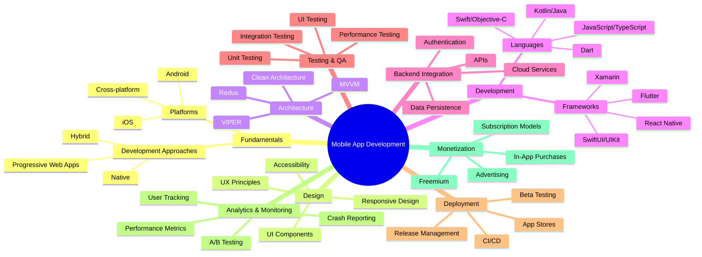

# Mobile App Development

[Back to Course Content](../README.md)

## 📱 Course Overview

This comprehensive module covers the entire lifecycle of mobile app development, equipping students with the knowledge and skills to design, develop, test, deploy, and monetize high-quality mobile applications. The course explores both platform-specific (Android, iOS) and cross-platform development approaches, emphasizing industry best practices and real-world applications.

### Why Study Mobile App Development?

- **Massive Market**: Mobile apps represent a $935 billion industry with continuing growth
- **Career Opportunities**: High demand for skilled mobile developers across industries
- **Innovation Platform**: Mobile is the primary platform for technological innovation
- **Direct User Impact**: Create software that reaches billions of users worldwide
- **Entrepreneurial Potential**: Build and launch your own products with global reach

## 🎯 Learning Outcomes

By the end of this module, students will be able to:

1. **Design and implement** mobile applications using modern frameworks and tools
2. **Apply industry best practices** for mobile app architecture, development, and testing
3. **Implement robust security measures** and optimize app performance across devices
4. **Analyze user behavior** through analytics and implement effective monetization strategies
5. **Navigate the app store ecosystem** and manage the complete release process
6. **Evaluate and select** appropriate technologies for specific mobile project requirements
7. **Troubleshoot and debug** complex mobile application issues
8. **Create inclusive applications** that follow accessibility guidelines

## 📚 Learning Paths

### Path 1: Mobile Fundamentals (Weeks 1-2)
- [Introduction to Mobile Development](introduction.md) → [Mobile UI/UX Design](ui-ux-design.md)

### Path 2: Architecture & Development (Weeks 3-5)
- [Mobile App Architecture](architecture.md) → [Mobile App Development](development.md) → [Mobile App Security](security.md)

### Path 3: Quality & Deployment (Weeks 6-8)
- [Mobile App Testing](testing.md) → [Mobile App Performance](performance.md) → [Mobile App Deployment](deployment.md)

### Path 4: Business & Analytics (Weeks 9-10)
- [Mobile App Analytics](analytics.md) → [Mobile App Monetization](monetization.md)

## 📋 Course Structure

### Foundation
1. [Introduction to Mobile Development](introduction.md)
   - Mobile platforms comparison (Android, iOS, cross-platform)
   - Development approaches (native, hybrid, cross-platform)
   - Mobile-specific constraints and capabilities
   - Development environments and toolchains
   - Mobile app lifecycle and structure

2. [Mobile UI/UX Design](ui-ux-design.md)
   - Mobile design principles and patterns
   - Platform-specific design guidelines
   - Responsive layouts and adaptive interfaces
   - Prototyping and mockup tools
   - Accessibility and inclusive design
   - UX research and usability testing

3. [Mobile App Architecture](architecture.md)
   - Architectural patterns (MVC, MVVM, Clean, VIPER)
   - Component design and separation of concerns
   - State management approaches
   - Dependency injection and inversion of control
   - Navigation patterns and deep linking
   - Offline-first architecture

### Core Development

4. [Mobile App Development](development.md)
   - Platform-specific development (Android, iOS)
   - Cross-platform frameworks (Flutter, React Native)
   - API integration and networking
   - Local data persistence (SQLite, Core Data, Room)
   - Background processing and multithreading
   - Resource management and optimization

5. [Mobile App Security](security.md)
   - Authentication and authorization
   - Secure data storage and transmission
   - Certificate pinning and network security
   - Code obfuscation and tampering protection
   - Privacy compliance (GDPR, CCPA)
   - Security testing and vulnerability assessment

6. [Mobile App Testing](testing.md)
   - Unit testing frameworks
   - UI testing and automation
   - Integration and end-to-end testing
   - Test-driven development for mobile
   - Device fragmentation testing
   - Continuous testing in CI/CD pipelines

### Optimization & Delivery

7. [Mobile App Performance](performance.md)
   - Performance profiling and monitoring
   - UI optimization techniques
   - Memory management and leak detection
   - Network optimization
   - Battery consumption optimization
   - App size reduction strategies

8. [Mobile App Deployment](deployment.md)
   - Build automation and CI/CD pipelines
   - App signing and code signing
   - App store optimization
   - Beta testing programs
   - Staged rollouts and feature flags
   - Update strategies and versioning

### Business & Analytics

9. [Mobile App Analytics](analytics.md)
   - Analytics implementation
   - User behavior tracking and funnels
   - Crash reporting and error tracking
   - A/B testing frameworks
   - Attribution and campaign tracking
   - Data-driven development

10. [Mobile App Monetization](monetization.md)
    - Revenue models comparison
    - In-app purchases implementation
    - Subscription management
    - Mobile advertising integration
    - Pricing strategies
    - Retention and engagement techniques

## 📊 Technology Comparison

| Technology | Pros | Cons | Best Use Cases |
|------------|------|------|----------------|
| **Native Android (Kotlin/Java)** | • Best performance • Full platform API access • First-class tools | • Platform-specific code • Higher development cost | • Graphics-intensive apps • Hardware integration • Platform-specific experiences |
| **Native iOS (Swift/Objective-C)** | • Optimized performance • Seamless iOS integration • Strong tooling | • iOS only • Requires Mac for development | • High-end iOS apps • Apple ecosystem integration • AR/VR applications |
| **Flutter** | • Single codebase • Near-native performance • Hot reload | • Larger app size • Newer ecosystem | • MVP development • Custom UI-heavy apps • Apps needing identical cross-platform UI |
| **React Native** | • JavaScript ecosystem • Native components • Extensive community | • Performance bottlenecks • Native bridges complexity | • Content-driven apps • Web-to-mobile transitions • Rapid prototyping |
| **Progressive Web Apps** | • Web distribution • No app store • Instant updates | • Limited native features • No store presence | • Content-focused apps • Enterprise applications • Reducing friction for casual users |

## 📝 Assessment Criteria

- **Assignments & Labs**: 30%
- **Mid-term Project**: 20%
- **Final Project**: 30%
- **Final Examination**: 20%

### Final Project Requirements

Students will develop a complete mobile application that demonstrates:
- Proper architecture and design patterns
- User-centered interface design
- Integration with backend services
- Comprehensive testing strategy
- Analytics implementation
- Monetization strategy (if applicable)
- Performance optimization

## 🔍 Prerequisites

- **Programming Experience**: Proficiency in at least one programming language (Java, JavaScript, etc.)
- **Object-Oriented Programming**: Understanding of OOP principles and patterns
- **Basic Web Technologies**: Knowledge of HTML, CSS, HTTP, and APIs
- **Development Environment**: Ability to set up and use IDEs and development tools
- **Source Control**: Basic proficiency with Git or similar version control systems

## 📚 Reference Materials

### Primary Textbooks
- "Android Programming: The Big Nerd Ranch Guide" by Phillips, Stewart & Marsicano
- "iOS Programming: The Big Nerd Ranch Guide" by Keur & Hillegass
- "Flutter in Action" by Eric Windmill
- "Programming React Native" by Dabit
- "Mobile Design Pattern Gallery" by Neil

### Online Resources
- [Android Developers](https://developer.android.com/)
- [Apple Developer Documentation](https://developer.apple.com/documentation/)
- [Flutter Documentation](https://flutter.dev/docs)
- [React Native Documentation](https://reactnative.dev/docs/getting-started)
- [Material Design Guidelines](https://material.io/design)
- [iOS Human Interface Guidelines](https://developer.apple.com/design/human-interface-guidelines/ios/overview/themes/)

## 🛠️ Tools and Resources

### Development Environments
- **Android Studio** for Android development
- **Xcode** for iOS development
- **Visual Studio Code** with extensions for cross-platform development
- **GitHub Codespaces** for cloud-based development

### Design Tools
- **Figma/Adobe XD** for UI/UX design and prototyping
- **Sketch** for iOS-specific design
- **Zeplin** for design handoff

### Testing Tools
- **JUnit/XCTest** for unit testing
- **Espresso/XCUITest** for UI testing
- **Appium** for cross-platform testing
- **Firebase Test Lab** for device testing

### Analytics and Monitoring
- **Firebase Analytics/Crashlytics**
- **Google Analytics for Mobile**
- **Mixpanel/Amplitude**
- **New Relic Mobile**

## 🌐 Real-world Applications

### Business Applications
- **E-commerce**: Mobile shopping experiences (Amazon, Shopify)
- **Finance**: Banking, investment, and payment apps (PayPal, Revolut)
- **Enterprise**: Internal business tools and workflows (Microsoft Teams, Slack)
- **Healthcare**: Patient monitoring and medical records (MyChart, Teladoc)

### Consumer Applications
- **Social Media**: Communication and content sharing (Instagram, TikTok)
- **Entertainment**: Streaming services and games (Netflix, Spotify)
- **Productivity**: Task management and note-taking (Notion, Todoist)
- **Utilities**: Tools addressing specific user needs (Google Maps, Weather apps)

### Emerging Categories
- **AR/VR Applications**: Enhanced reality experiences (Pokémon GO, IKEA Place)
- **IoT Control**: Smart home and device management (Philips Hue, Samsung SmartThings)
- **Health Tech**: Fitness tracking and health monitoring (Fitbit, Apple Health)
- **On-demand Services**: Location-based service delivery (Uber, DoorDash)

## 🚀 Getting Started

1. **Set up your development environment**
   - Install platform-specific tools (Android Studio, Xcode)
   - Configure cross-platform frameworks if applicable
   - Set up version control and CI/CD

2. **Learn platform fundamentals**
   - Understand mobile app lifecycle
   - Study platform-specific UI components
   - Explore navigation patterns

3. **Build your first app**
   - Start with a simple project
   - Implement basic functionality
   - Deploy to a physical device

4. **Expand your knowledge**
   - Add advanced features
   - Optimize performance
   - Implement analytics

## 🤝 Support and Community

- **Discussion Forums**: Course-specific Slack channel for peer interaction
- **Office Hours**: Weekly scheduled time with instructors and TAs
- **Code Reviews**: Peer and instructor reviews of project milestones
- **Resource Library**: Curated collection of articles, videos, and tutorials

## 📞 Contact Information

- **Course Instructor**: Prof. Michael Chen (m.chen@university.edu)
- **Teaching Assistants**:
  - Sarah Johnson (s.johnson@university.edu) - Android Specialist
  - David Rodriguez (d.rodriguez@university.edu) - iOS Specialist
  - Priya Patel (p.patel@university.edu) - Cross-platform Specialist
- **Technical Support**: techsupport@university.edu 