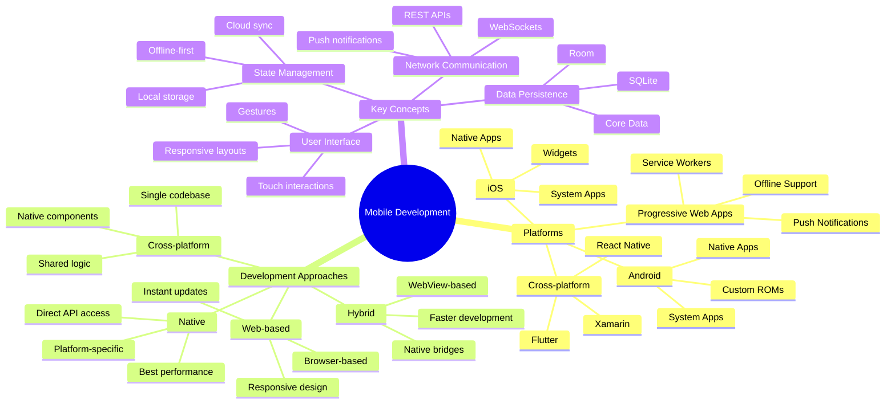

# Introduction to Mobile Development

[Back to Course Content](README.md) | [Next: Mobile UI/UX Design →](ui-ux-design.md)

> Reference: This content is based on 1.pdf and 2.pdf

## 📱 What is Mobile Development?

Mobile development is the process of creating software applications that run on mobile devices. It involves designing, developing, testing, and deploying applications for various mobile platforms, considering the unique constraints and capabilities of mobile environments.

### Key Characteristics of Mobile Development:

1. **Platform Diversity**
   - Multiple operating systems (Android, iOS)
   - Various screen sizes and resolutions
   - Different hardware capabilities
   - Network connectivity variations

2. **User-Centric Design**
   - Touch-based interfaces
   - Gesture recognition
   - Context-aware features
   - Offline functionality

3. **Resource Constraints**
   - Limited battery life
   - Memory restrictions
   - Processing power limitations
   - Storage space considerations



## 📊 Market Overview and Industry Trends

### Current Market Statistics
- Global mobile app revenue: $935 billion (2023)
- Number of mobile app downloads: 255 billion (2022)
- Average time spent on mobile: 4.8 hours daily
- Mobile commerce growth: 72% YoY

### Industry Trends
1. **Emerging Technologies**
   - 5G and edge computing
   - Augmented Reality (AR)
   - Artificial Intelligence (AI)
   - Internet of Things (IoT)

2. **Development Paradigms**
   - Cross-platform dominance
   - Low-code/No-code platforms
   - Progressive Web Apps (PWAs)
   - Microservices architecture

3. **User Expectations**
   - Instant loading
   - Offline functionality
   - Personalization
   - Privacy focus

## 📈 Historical Evolution of Mobile Development

The field of mobile application development has evolved significantly over the past decades:

| Era | Time Period | Key Characteristics | Notable Platforms | Market Impact |
|-----|-------------|---------------------|-------------------|---------------|
| Early Mobile | 1990s - 2006 | • Simple applications<br>• Limited capabilities<br>• Proprietary platforms<br>• Basic UI | • Nokia Symbian<br>• BlackBerry OS<br>• Palm OS<br>• Windows Mobile | • Basic communication<br>• Limited app ecosystem<br>• High development costs |
| Smartphone Revolution | 2007 - 2010 | • Touch interfaces<br>• App stores<br>• Improved connectivity<br>• Rich media support | • iOS<br>• Android<br>• Windows Mobile<br>• WebOS | • App store economy<br>• Developer opportunities<br>• User experience focus |
| Modern Mobile | 2011 - Present | • Advanced capabilities<br>• Cross-platform frameworks<br>• Cloud integration<br>• AI/ML features | • iOS/Android<br>• Flutter/React Native<br>• PWAs<br>• Wearables | • Global app economy<br>• Platform democratization<br>• Innovation acceleration |

## 🌐 Mobile Platforms Overview

### 1. Android Development

The Android platform, developed by Google, is based on the Linux kernel and uses Java/Kotlin for application development.

#### Key Android Concepts:

1. **Core Components**
   - **Activities**: Single, focused operations users can perform
   - **Fragments**: Modular sections of an activity's UI
   - **Intents**: Messaging objects for requesting actions
   - **Services**: Long-running operations in the background
   - **Content Providers**: Managing shared application data
   - **Broadcast Receivers**: Components responding to system-wide events

2. **Development Tools**
   - Android Studio
   - Gradle build system
   - Android Debug Bridge (ADB)
   - Android Emulator
   - Layout Inspector

```java
// Example: Basic Android Activity with Modern Architecture
public class MainActivity extends AppCompatActivity {
    private ActivityMainBinding binding;
    private MainViewModel viewModel;

    @Override
    protected void onCreate(Bundle savedInstanceState) {
        super.onCreate(savedInstanceState);
        binding = ActivityMainBinding.inflate(getLayoutInflater());
        setContentView(binding.getRoot());

        viewModel = new ViewModelProvider(this).get(MainViewModel.class);
        setupObservers();
        setupClickListeners();
    }

    private void setupObservers() {
        viewModel.getData().observe(this, data -> {
            binding.textView.setText(data);
        });
    }

    private void setupClickListeners() {
        binding.button.setOnClickListener(v -> {
            viewModel.performAction();
        });
    }
}
```

### 2. iOS Development

The iOS platform, developed by Apple, uses Swift/Objective-C for application development and follows the Cocoa Touch framework principles.

#### Key iOS Concepts:

1. **Core Components**
   - **View Controllers**: Managing views and mediating between views and data
   - **Delegates**: Protocol-based communication between objects
   - **Blocks/Closures**: Self-contained units of functionality
   - **Notification Center**: Broadcasting information across the app
   - **Core Data**: Object graph and persistence framework
   - **UIKit/SwiftUI**: Framework for handling UI components and interactions

2. **Development Tools**
   - Xcode
   - Interface Builder
   - Instruments
   - Simulator
   - TestFlight

```swift
// Example: Modern iOS View Controller with SwiftUI
struct ContentView: View {
    @StateObject private var viewModel = ContentViewModel()
    
    var body: some View {
        NavigationView {
            List(viewModel.items) { item in
                ItemRow(item: item)
            }
            .navigationTitle("My App")
            .toolbar {
                ToolbarItem(placement: .navigationBarTrailing) {
                    Button(action: { viewModel.addItem() }) {
                        Image(systemName: "plus")
                    }
                }
            }
        }
    }
}

class ContentViewModel: ObservableObject {
    @Published var items: [Item] = []
    
    func addItem() {
        items.append(Item(title: "New Item"))
    }
}
```

### 3. Cross-platform Development

Cross-platform frameworks allow developers to write code once and deploy to multiple platforms, reducing development time and maintenance costs.

#### Key Cross-platform Frameworks:

1. **Flutter**
   - Google's UI toolkit
   - Dart programming language
   - Native performance
   - Hot reload capability

2. **React Native**
   - Facebook's framework
   - JavaScript/TypeScript
   - Native components
   - Large ecosystem

3. **Xamarin**
   - Microsoft's framework
   - C# programming language
   - Native performance
   - Enterprise focus

4. **Ionic**
   - Web technologies
   - Angular/React/Vue support
   - Progressive Web Apps
   - Rapid development

#### Technology Comparison Matrix

| Aspect | Native Development | Cross-platform Development | Hybrid Development | PWA |
|--------|-------------------|---------------------------|-------------------|-----|
| Performance | ⭐⭐⭐⭐⭐ | ⭐⭐⭐⭐ | ⭐⭐ | ⭐⭐⭐ |
| Development Speed | ⭐⭐ | ⭐⭐⭐⭐ | ⭐⭐⭐⭐ | ⭐⭐⭐⭐ |
| Code Reuse | ⭐ | ⭐⭐⭐⭐ | ⭐⭐⭐⭐ | ⭐⭐⭐⭐⭐ |
| Native Features | ⭐⭐⭐⭐⭐ | ⭐⭐⭐ | ⭐⭐ | ⭐ |
| UI Consistency | ⭐⭐⭐⭐⭐ | ⭐⭐⭐ | ⭐⭐⭐ | ⭐⭐⭐⭐ |
| Maintenance | ⭐⭐ | ⭐⭐⭐⭐ | ⭐⭐⭐ | ⭐⭐⭐⭐⭐ |

## 🛠️ Development Environments

### 1. Android Studio

Android Studio is the official Integrated Development Environment (IDE) for Android development, built on IntelliJ IDEA.

#### Key Features:
- Gradle-based build system
- Code editor with advanced features
- Visual layout editor
- APK analyzer
- Performance profilers
- Emulator integration

```xml
<!-- Example: Modern Android Layout with ConstraintLayout -->
<?xml version="1.0" encoding="utf-8"?>
<androidx.constraintlayout.widget.ConstraintLayout 
    xmlns:android="http://schemas.android.com/apk/res/android"
    xmlns:app="http://schemas.android.com/apk/res-auto"
    android:layout_width="match_parent"
    android:layout_height="match_parent">

    <com.google.android.material.card.MaterialCardView
        android:id="@+id/card"
        android:layout_width="match_parent"
        android:layout_height="wrap_content"
        android:layout_margin="16dp"
        app:cardCornerRadius="8dp"
        app:cardElevation="4dp"
        app:layout_constraintTop_toTopOf="parent">

        <LinearLayout
            android:layout_width="match_parent"
            android:layout_height="wrap_content"
            android:orientation="vertical"
            android:padding="16dp">

            <TextView
                android:id="@+id/title"
                android:layout_width="wrap_content"
                android:layout_height="wrap_content"
                android:textSize="18sp"
                android:textStyle="bold" />

            <com.google.android.material.button.MaterialButton
                android:id="@+id/button"
                android:layout_width="wrap_content"
                android:layout_height="wrap_content"
                android:layout_marginTop="8dp"
                android:text="Action" />

        </LinearLayout>

    </com.google.android.material.card.MaterialCardView>

</androidx.constraintlayout.widget.ConstraintLayout>
```

### 2. Xcode

Xcode is Apple's IDE for developing iOS, macOS, watchOS, and tvOS applications.

#### Key Features:
- Interface Builder for visual UI design
- Swift/Objective-C support
- Simulator for testing
- Instruments for profiling
- TestFlight integration
- App Store submission tools

```swift
// Example: Modern iOS App with SwiftUI
@main
struct MyApp: App {
    @StateObject private var appState = AppState()
    
    var body: some Scene {
        WindowGroup {
            ContentView()
                .environmentObject(appState)
        }
    }
}

class AppState: ObservableObject {
    @Published var isAuthenticated = false
    @Published var currentUser: User?
    
    func signIn() {
        // Authentication logic
    }
    
    func signOut() {
        // Sign out logic
    }
}
```

### 3. VS Code with Flutter

Visual Studio Code with Flutter extensions provides a lightweight yet powerful environment for cross-platform development.

#### Key Features:
- Cross-platform IDE
- Extensive plugin ecosystem
- Integrated debugging
- Hot reload support
- Widget inspector
- Performance analysis

```yaml
# Example: Flutter Configuration with Modern Features
flutter:
  uses-material-design: true
  
  assets:
    - assets/images/
    - assets/fonts/
    - assets/icons/
    
  dependencies:
    flutter:
      sdk: flutter
    http: ^0.13.0
    provider: ^6.0.0
    shared_preferences: ^2.0.0
    flutter_bloc: ^8.0.0
    get_it: ^7.0.0
    injectable: ^2.0.0
    
  dev_dependencies:
    flutter_test:
      sdk: flutter
  build_runner: ^2.0.0
  injectable_generator: ^2.0.0
```

## 🔄 Mobile Development Fundamentals

### 1. Application Lifecycle

Understanding the application lifecycle is crucial for proper resource management, UI updates, and handling system events.

#### Key Lifecycle States:

1. **Initialization**
   - Application loading
   - Resource allocation
   - Initial setup
   - Configuration loading

2. **Active/Running**
   - Visible and interactive
   - Receiving user input
   - Processing data
   - Updating UI

3. **Background**
   - Not visible but loaded
   - Limited resource usage
   - Background tasks
   - State preservation

4. **Suspended**
   - In memory but inactive
   - No code execution
   - State maintained
   - Ready for resume

5. **Terminated**
   - Removed from memory
   - Resources freed
   - State lost
   - Requires restart

```java
// Example: Android Activity Lifecycle with Modern Architecture
public class MainActivity extends AppCompatActivity {
    private ActivityMainBinding binding;
    private MainViewModel viewModel;

    @Override
    protected void onCreate(Bundle savedInstanceState) {
        super.onCreate(savedInstanceState);
        binding = ActivityMainBinding.inflate(getLayoutInflater());
        setContentView(binding.getRoot());

        viewModel = new ViewModelProvider(this).get(MainViewModel.class);
        setupObservers();
        setupClickListeners();
    }

    @Override
    protected void onStart() {
        super.onStart();
        viewModel.onStart();
    }

    @Override
    protected void onResume() {
        super.onResume();
        viewModel.onResume();
    }

    @Override
    protected void onPause() {
        super.onPause();
        viewModel.onPause();
    }

    @Override
    protected void onStop() {
        super.onStop();
        viewModel.onStop();
    }

    @Override
    protected void onDestroy() {
        super.onDestroy();
        viewModel.onDestroy();
    }
}
```

### 2. User Interface Components

Mobile interfaces are composed of standardized UI components that follow platform-specific design guidelines.

#### Common UI Component Types:

1. **Containers**
   - LinearLayout/StackView
   - RelativeLayout/ConstraintLayout
   - ScrollView/ScrollView
   - GridLayout/UICollectionView

2. **Input Controls**
   - TextInput/TextField
   - Button/UIButton
   - Checkbox/CheckBox
   - RadioButton/RadioButton

3. **Informational Elements**
   - TextView/Label
   - ImageView/ImageView
   - ProgressBar/ProgressView
   - WebView/WKWebView

4. **Navigation Components**
   - NavigationView/NavigationController
   - TabLayout/TabBarController
   - BottomNavigationView/TabBar
   - DrawerLayout/SideMenu

5. **Dialogs & Popups**
   - AlertDialog/UIAlertController
   - BottomSheet/BottomSheet
   - ModalBottomSheet/ModalPresentation
   - Snackbar/Toast

```dart
// Example: Modern Flutter UI with Material Design 3
class MyApp extends StatelessWidget {
  @override
  Widget build(BuildContext context) {
    return MaterialApp(
      theme: ThemeData(
        useMaterial3: true,
        colorScheme: ColorScheme.fromSeed(
          seedColor: Colors.blue,
          brightness: Brightness.light,
        ),
      ),
      home: Scaffold(
        appBar: AppBar(
          title: Text('My App'),
          actions: [
            IconButton(
              icon: Icon(Icons.settings),
              onPressed: () {
                // Handle settings
              },
            ),
          ],
        ),
        body: ListView.builder(
          itemCount: 10,
          itemBuilder: (context, index) {
            return Card(
              child: ListTile(
                leading: CircleAvatar(
                  child: Text('${index + 1}'),
                ),
                title: Text('Item ${index + 1}'),
                subtitle: Text('Description for item ${index + 1}'),
                trailing: Icon(Icons.arrow_forward_ios),
                onTap: () {
                  // Handle tap
                },
              ),
            );
          },
        ),
        floatingActionButton: FloatingActionButton.extended(
          onPressed: () {
            // Handle FAB press
          },
          label: Text('Add Item'),
          icon: Icon(Icons.add),
        ),
      ),
    );
  }
}
```

### 3. Mobile-Specific Constraints and Capabilities

Mobile development requires considering specific constraints and leveraging unique capabilities.

#### Constraints:

1. **Hardware Limitations**
   - Limited processing power
   - Memory restrictions
   - Storage space
   - Battery life

2. **Network Considerations**
   - Variable connectivity
   - Bandwidth limitations
   - Data costs
   - Offline scenarios

3. **User Experience**
   - Touch input
   - Screen size variations
   - Device orientation
   - Accessibility requirements

#### Capabilities:

1. **Hardware Features**
   - Camera/Microphone
   - GPS/Location
   - Sensors (Accelerometer, Gyroscope)
   - Biometric authentication

2. **Connectivity Options**
   - Cellular networks
   - WiFi
   - Bluetooth
   - NFC

3. **Platform Features**
   - Push notifications
   - Background services
   - Widgets
   - Deep linking

## 🛠️ Tools and Frameworks

### 1. Version Control

Version control systems are essential for team collaboration and code management in mobile development.

```bash
# Example: Git Workflow for Mobile Development
# Initialize repository
git init

# Add remote repository
git remote add origin <repository-url>

# Create feature branch
git checkout -b feature/new-feature

# Stage changes
git add .

# Commit changes
git commit -m "Add new feature"

# Push changes
git push origin feature/new-feature

# Create pull request
# (via GitHub/GitLab interface)
```

### 2. Package Management

Package managers facilitate the integration of third-party libraries and dependencies into mobile applications.

```yaml
# Example: Flutter Dependencies with Version Management
dependencies:
  flutter:
    sdk: flutter
  cupertino_icons: ^1.0.2
  http: ^0.13.0
  provider: ^6.0.0
  shared_preferences: ^2.0.0
  flutter_bloc: ^8.0.0
  get_it: ^7.0.0
  injectable: ^2.0.0
  json_annotation: ^4.8.0
  freezed_annotation: ^2.3.0

dev_dependencies:
  flutter_test:
    sdk: flutter
  build_runner: ^2.0.0
  injectable_generator: ^2.0.0
  json_serializable: ^6.6.0
  freezed: ^2.3.0
```

### 3. Testing Tools

Comprehensive testing ensures application quality across various devices and scenarios.

```dart
// Example: Flutter Test with Mocking
void main() {
  late MockUserRepository mockRepository;
  late UserBloc userBloc;

  setUp(() {
    mockRepository = MockUserRepository();
    userBloc = UserBloc(repository: mockRepository);
  });

  test('should emit [Loading, Loaded] when data is fetched successfully', () {
    // Arrange
    when(mockRepository.getUsers())
        .thenAnswer((_) async => [User(id: '1', name: 'Test')]);

    // Act
    userBloc.add(LoadUsers());

    // Assert
    expect(
      userBloc.stream,
      emitsInOrder([
        UserLoading(),
        UserLoaded([User(id: '1', name: 'Test')]),
      ]),
    );
  });
}
```

## 🔄 Mobile Development Paradigms

### 1. Declarative UI

Modern mobile frameworks are moving toward declarative UI patterns, where developers describe what the UI should look like rather than how to create it.

#### Benefits:
- Reduced state management complexity
- More predictable rendering
- Easier testing and debugging
- Better performance optimization

### 2. Reactive Programming

Reactive programming focuses on data flows and the propagation of changes, which is particularly valuable for dynamic mobile interfaces.

#### Key Concepts:
- **Observables**: Data sources that can be observed for changes
- **Subscribers**: Components that react to changes in observables
- **Operators**: Functions for transforming data streams
- **Schedulers**: Controlling when and where computation occurs

### 3. Offline-First Design

Offline-first is an architectural approach that prioritizes functioning without a network connection.

#### Implementation Strategies:
- Local data persistence
- Optimistic UI updates
- Background synchronization
- Conflict resolution
- Progressive enhancement

## ✅ Best Practices

1. **Development**
   - Follow platform guidelines and patterns
   - Use appropriate architecture patterns (MVVM, Clean Architecture, etc.)
   - Implement proper error handling and graceful degradation
   - Write clean, maintainable code with clear separation of concerns
   - Optimize for battery and data usage

2. **Testing**
   - Write comprehensive unit tests for business logic
   - Perform UI testing with automation tools
   - Conduct integration testing across components
   - Test on multiple devices and OS versions
   - Implement analytics for real-world usage data

3. **Performance**
   - Optimize app size through code splitting and asset compression
   - Minimize network calls with caching and batching
   - Implement efficient state management
   - Handle memory efficiently with proper resource cleanup
   - Profile and optimize rendering performance

## ⚠️ Common Pitfalls

1. **Development Issues**
   - Platform-specific API inconsistencies
   - Version compatibility across different OS versions
   - Performance problems on low-end devices
   - Security vulnerabilities in data storage and transmission
   - Inadequate error handling and recovery mechanisms

2. **Testing Issues**
   - Device fragmentation leading to inconsistent behavior
   - OS version differences affecting functionality
   - Network condition variations impacting user experience
   - Battery consumption patterns varying by device
   - Input method differences (touch, keyboard, voice)

3. **Deployment Issues**
   - App store guidelines and review process delays
   - Version management across different distribution channels
   - Update distribution and adoption rates
   - User feedback handling and iteration cycles
   - Feature parity across platforms

## 📚 Mobile Development Glossary

| Term | Definition | Example Usage |
|------|------------|---------------|
| **API** | Application Programming Interface | REST API endpoints for data exchange |
| **APK** | Android Package Kit | Distribution format for Android apps |
| **IPA** | iOS App Store Package | Distribution format for iOS apps |
| **SDK** | Software Development Kit | Android SDK, iOS SDK |
| **IDE** | Integrated Development Environment | Android Studio, Xcode |
| **ADB** | Android Debug Bridge | Debugging Android devices |
| **Gradle** | Build automation system | Android app building |
| **CocoaPods** | Dependency manager | iOS library management |
| **Hot Reload** | Live code update feature | Flutter development |
| **Material Design** | Google's design language | Android UI guidelines |
| **HIG** | Human Interface Guidelines | Apple's iOS design guidelines |
| **PWA** | Progressive Web App | Web-based mobile app |
| **WebView** | Browser component | In-app web content |
| **Deep Linking** | Direct app content access | URL scheme handling |
| **Push Notification** | Server-sent messages | User engagement alerts |

## 🎯 Exercises

1. **Environment Setup**
   - Set up Android Studio and Xcode
   - Configure Flutter development environment
   - Install necessary SDKs and tools
   - Set up version control

2. **Basic App Development**
   - Create a simple app on both platforms
   - Implement basic UI components
   - Handle user input
   - Add navigation

3. **Advanced Features**
   - Implement state management
   - Add data persistence
   - Handle network requests
   - Implement error handling

4. **Cross-platform Development**
   - Create a Flutter app
   - Implement platform-specific features
   - Handle responsive design
   - Test on multiple devices

5. **Testing and Optimization**
   - Write unit tests
   - Implement UI tests
   - Profile app performance
   - Optimize resource usage

## 📚 Additional Resources

### Official Documentation
- [Android Developer Guide](https://developer.android.com/guide)
- [iOS Developer Guide](https://developer.apple.com/guide/)
- [Flutter Documentation](https://flutter.dev/docs)
- [React Native Documentation](https://reactnative.dev/docs/getting-started)

### Design Guidelines
- [Material Design Guidelines](https://material.io/design)
- [Apple Human Interface Guidelines](https://developer.apple.com/design/human-interface-guidelines/)
- [Flutter Design Guidelines](https://flutter.dev/docs/development/ui/layout)

### Community Resources
- [Stack Overflow Mobile Development](https://stackoverflow.com/questions/tagged/mobile-development)
- [GitHub Mobile Development](https://github.com/topics/mobile-development)
- [Reddit Mobile Development](https://www.reddit.com/r/mobiledevelopment/)
- [Mobile Development Discord](https://discord.gg/mobile-development) 