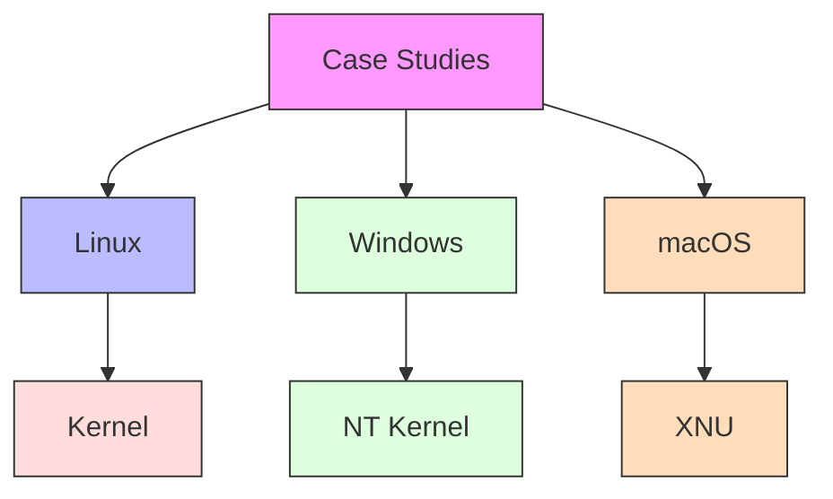
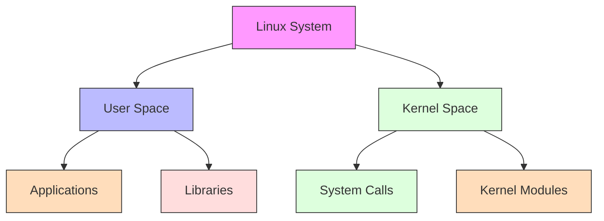
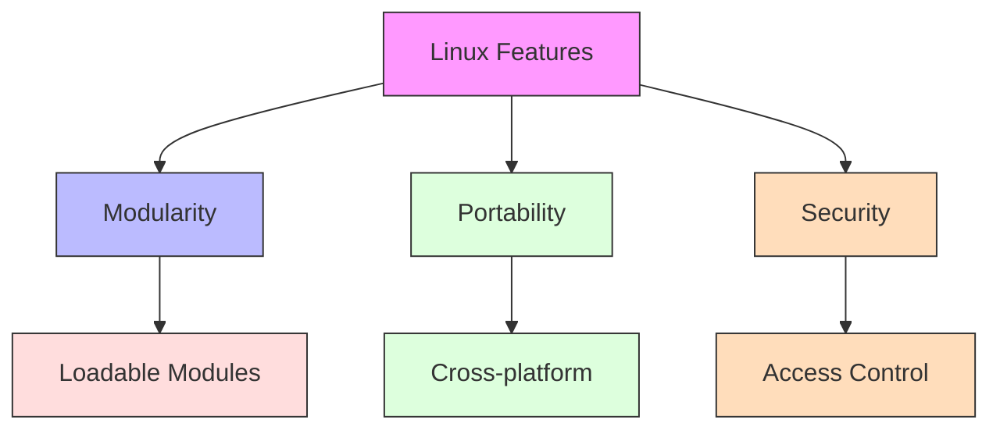
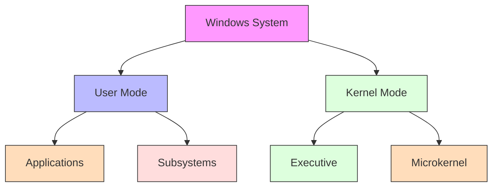
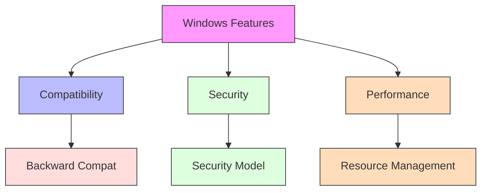
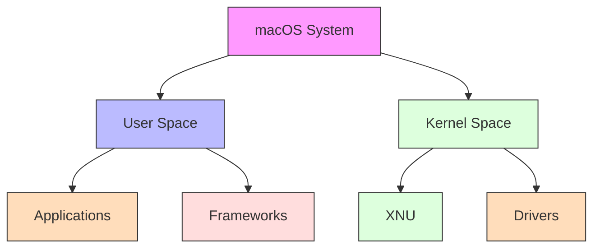
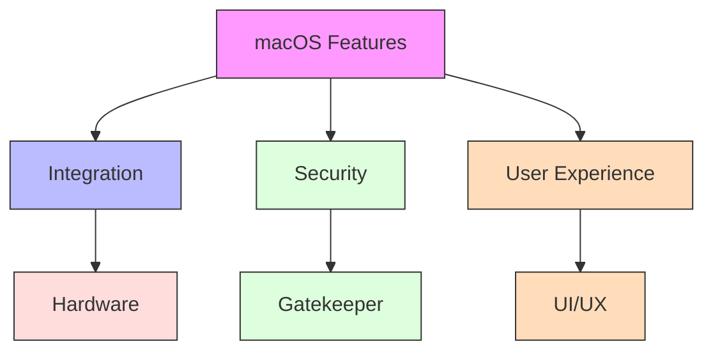
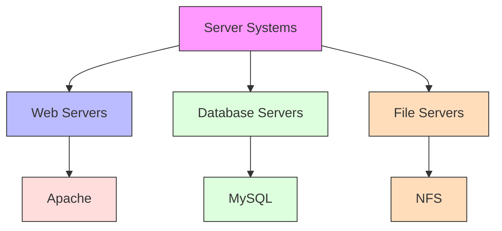
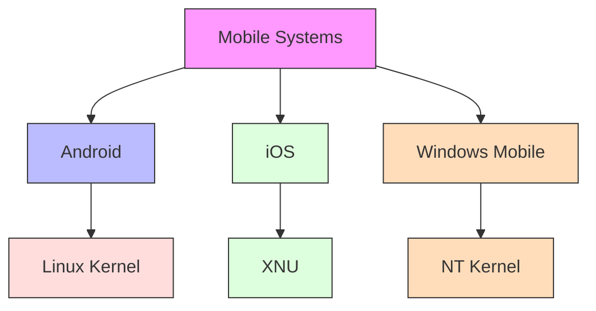
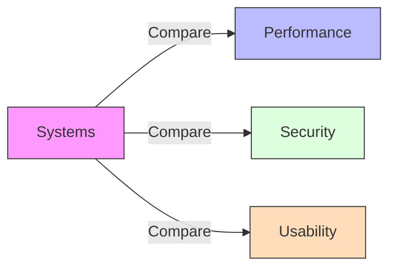

# Case Studies

[Back to Course Content](README.md) | [Previous: Cloud Computing](cloud-computing.md) | [Next: Future Trends →](future-trends.md)

## What are Case Studies?

Case studies provide real-world examples and analysis of operating system implementations, helping understand practical applications and challenges.

## Linux Case Study

### System Architecture

### Key Features

## Windows Case Study

### System Architecture

### Key Features

## macOS Case Study

### System Architecture

### Key Features

## Real-World Applications

### Server Systems

### Mobile Systems

## Performance Analysis

### System Comparison

### Analysis Techniques

1. **Performance Metrics**
   - Response time
   - Throughput
   - Resource utilization

2. **Security Analysis**
   - Vulnerability assessment
   - Access control
   - Audit trails

3. **Usability Studies**
   - User interface
   - System administration
   - Application support

## Summary

Case studies provide valuable insights into real-world operating system implementations and their practical applications. Understanding different system architectures and features helps in making informed decisions about system selection and design.

The analysis of different operating systems reveals their strengths and weaknesses in various application scenarios.

## References and Further Reading

- Silberschatz, A., Galvin, P. B., & Gagne, G. (2018). *Operating System Concepts* (10th Edition). Wiley.
- Tanenbaum, A. S., & Bos, H. (2014). *Modern Operating Systems* (4th Edition). Pearson.
- Stevens, W. R., & Rago, S. A. (2013). *Advanced Programming in the UNIX Environment* (3rd Edition). Addison-Wesley.
- Bryant, R. E., & O'Hallaron, D. R. (2015). *Computer Systems: A Programmer's Perspective* (3rd Edition). Pearson.
- Love, R. (2013). *Linux System Programming* (2nd Edition). O'Reilly Media. 