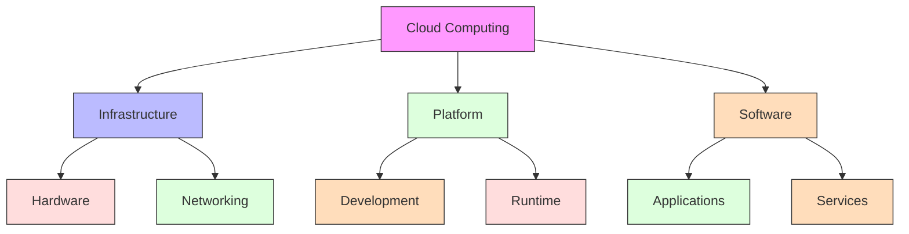
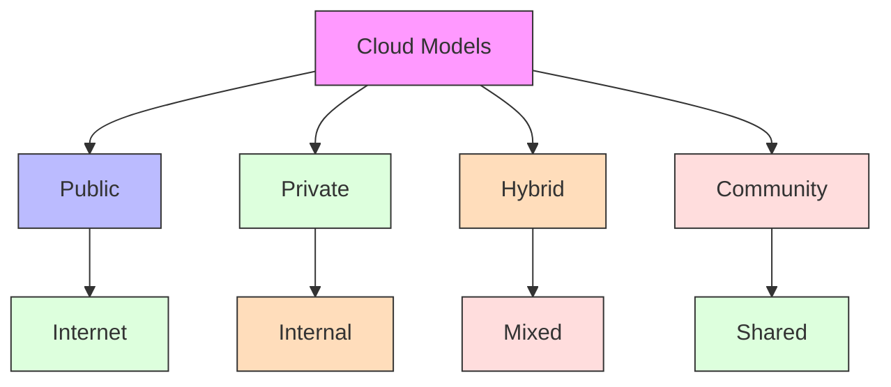
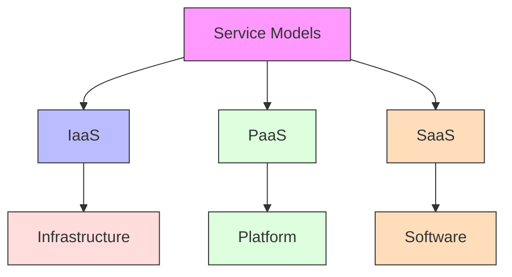
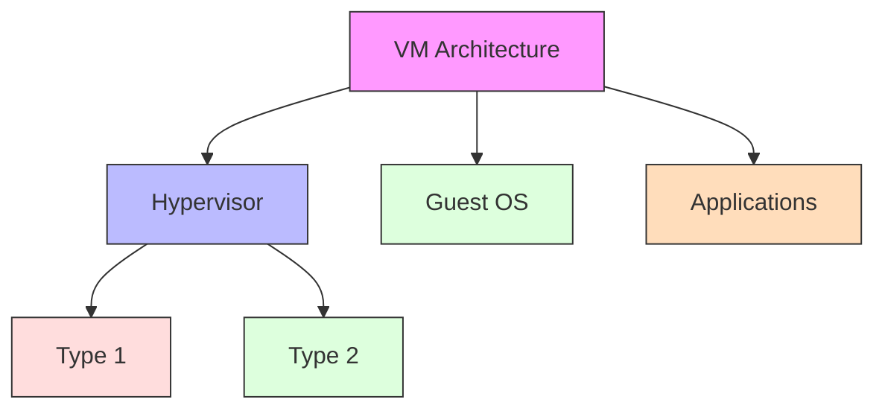
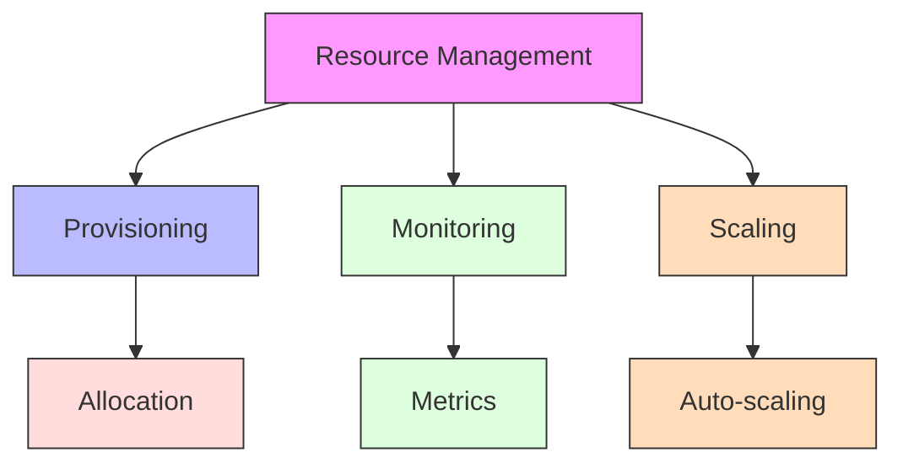
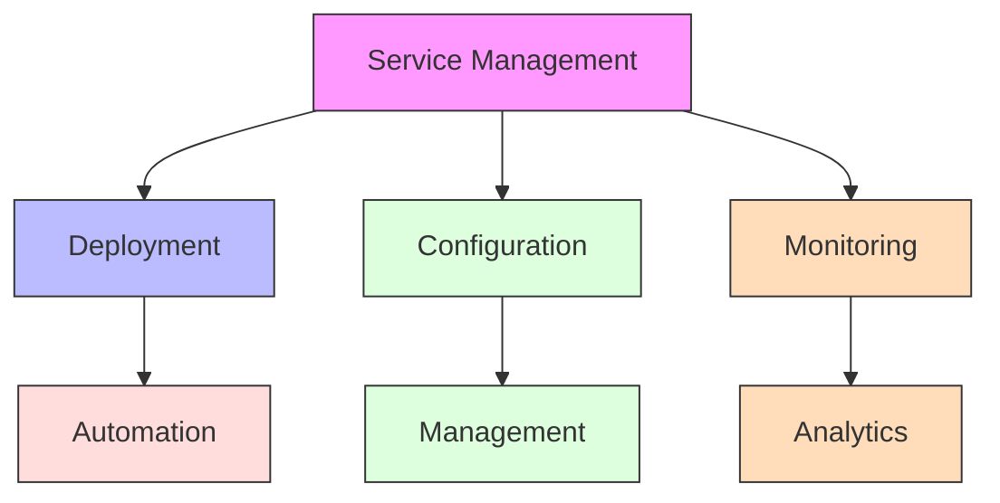
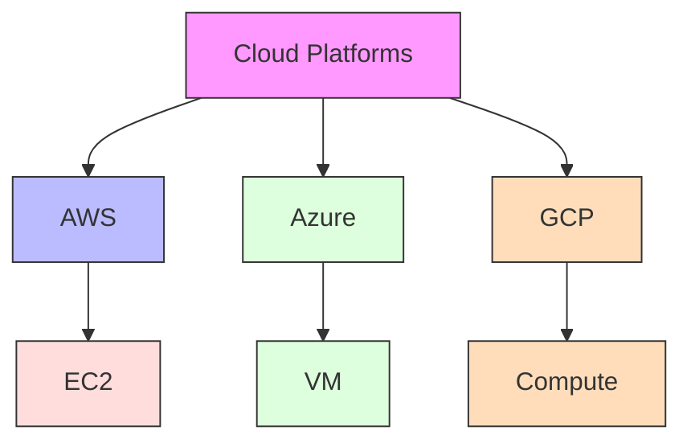
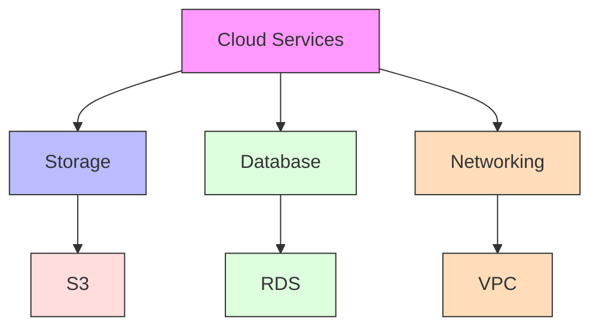
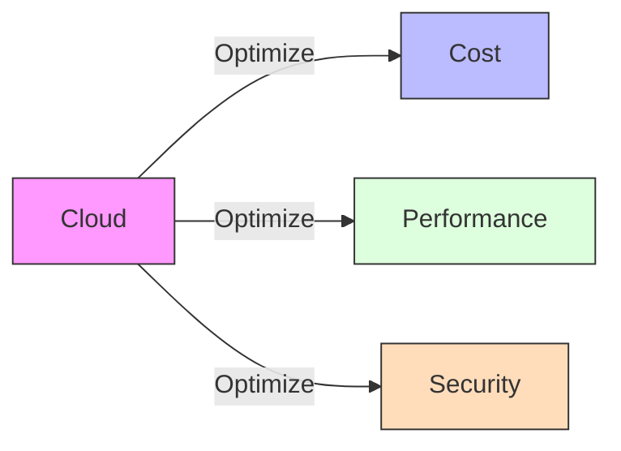

# Cloud Computing

[Back to Course Content](README.md) | [Previous: Distributed Systems](distributed-systems.md) | [Next: Case Studies →](case-studies.md)

## What is Cloud Computing?

Cloud computing is the delivery of computing services over the internet, providing scalable and on-demand access to shared resources.

## Cloud Models

### Deployment Models

### Service Models

## Virtualization

### Types of Virtualization

```mermaid
graph TD
    A[Virtualization] --> B[Hardware]
    A --> C[Operating System]
    A --> D[Application]
    
    B --> E[VM]
    C --> F[Container]
    D --> G[Process]
    
    style A fill:#f9f,stroke:#333
    style B fill:#bbf,stroke:#333
    style C fill:#dfd,stroke:#333
    style D fill:#fdb,stroke:#333
    style E fill:#fdd,stroke:#333
    style F fill:#dfd,stroke:#333
    style G fill:#fdb,stroke:#333
```

### Virtual Machine Architecture

## Cloud Management

### Resource Management

### Service Management

## Real-World Applications

### Cloud Platforms

### Cloud Services

## Performance Considerations

### Cloud Optimization

### Optimization Techniques

1. **Resource Optimization**
   - Auto-scaling
   - Load balancing
   - Resource pooling

2. **Cost Optimization**
   - Reserved instances
   - Spot instances
   - Resource scheduling

3. **Performance Optimization**
   - Caching
   - CDN
   - Database optimization

## Summary

Cloud computing provides flexible and scalable computing resources over the internet. Understanding cloud models, virtualization, and management techniques is essential for building and deploying cloud applications.

The choice of cloud services and optimization strategies depends on various factors including application requirements, cost constraints, and performance needs.

## References and Further Reading

- Silberschatz, A., Galvin, P. B., & Gagne, G. (2018). *Operating System Concepts* (10th Edition). Wiley.
- Tanenbaum, A. S., & Bos, H. (2014). *Modern Operating Systems* (4th Edition). Pearson.
- Stevens, W. R., & Rago, S. A. (2013). *Advanced Programming in the UNIX Environment* (3rd Edition). Addison-Wesley.
- Bryant, R. E., & O'Hallaron, D. R. (2015). *Computer Systems: A Programmer's Perspective* (3rd Edition). Pearson.
- Love, R. (2013). *Linux System Programming* (2nd Edition). O'Reilly Media. 