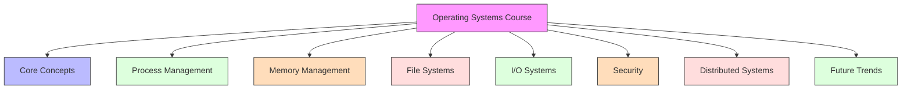
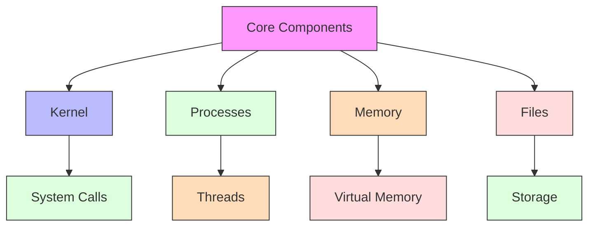
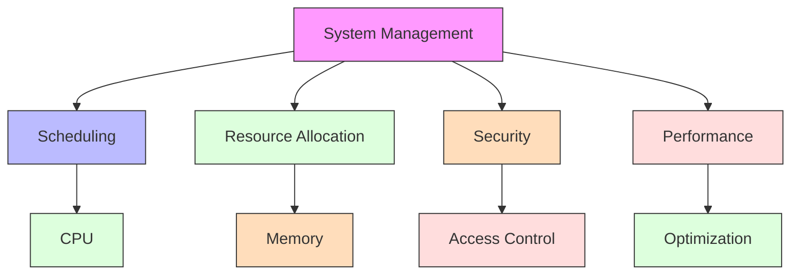
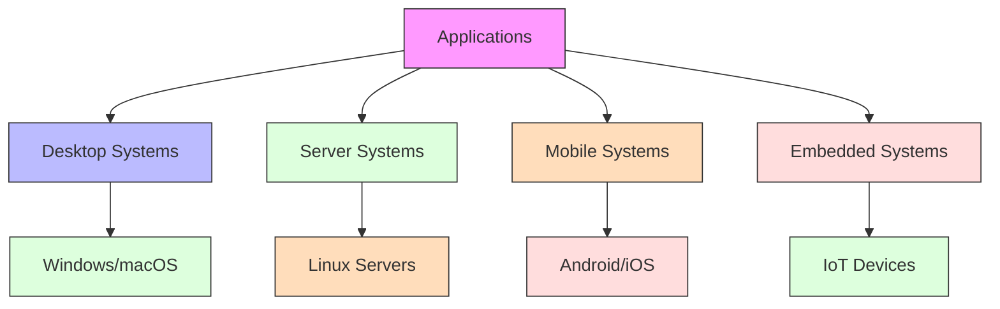
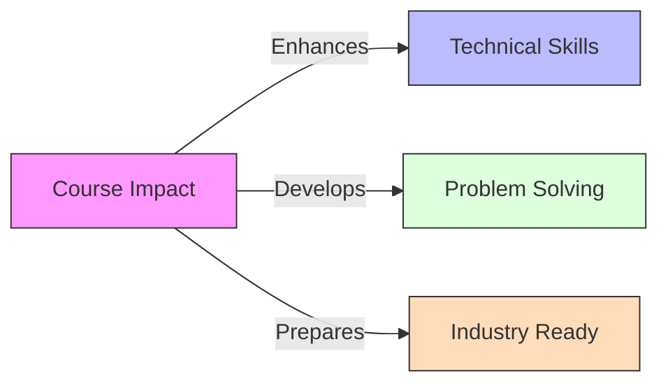

# Conclusion

[Back to Course Content](README.md) | [Previous: Future Trends](future-trends.md)

## Course Overview

## Key Concepts Summary

### Core Components

### System Management

## Learning Outcomes

1. **Understanding Core Concepts**
   - Operating system architecture
   - Process and thread management
   - Memory management
   - File systems
   - I/O systems

2. **System Programming Skills**
   - System calls
   - Process creation
   - Memory allocation
   - File operations
   - Interprocess communication

3. **Problem-Solving Abilities**
   - Resource management
   - Performance optimization
   - Security implementation
   - System design
   - Troubleshooting

## Real-World Applications

## Future Directions

1. **Emerging Technologies**
   - AI integration
   - Edge computing
   - Quantum computing
   - Cloud systems
   - IoT devices

2. **Research Areas**
   - System optimization
   - Security enhancement
   - Resource management
   - Performance tuning
   - User experience

3. **Industry Trends**
   - Containerization
   - Microservices
   - Cloud-native systems
   - Edge computing
   - Smart systems

## Course Impact

## Final Thoughts

The study of operating systems provides a fundamental understanding of computer systems and their management. This knowledge is essential for:

1. System programming
2. Software development
3. System administration
4. Research and innovation
5. Industry applications

## References and Further Reading

- Silberschatz, A., Galvin, P. B., & Gagne, G. (2018). *Operating System Concepts* (10th Edition). Wiley.
- Tanenbaum, A. S., & Bos, H. (2014). *Modern Operating Systems* (4th Edition). Pearson.
- Stevens, W. R., & Rago, S. A. (2013). *Advanced Programming in the UNIX Environment* (3rd Edition). Addison-Wesley.
- Bryant, R. E., & O'Hallaron, D. R. (2015). *Computer Systems: A Programmer's Perspective* (3rd Edition). Pearson.
- Love, R. (2013). *Linux System Programming* (2nd Edition). O'Reilly Media. 