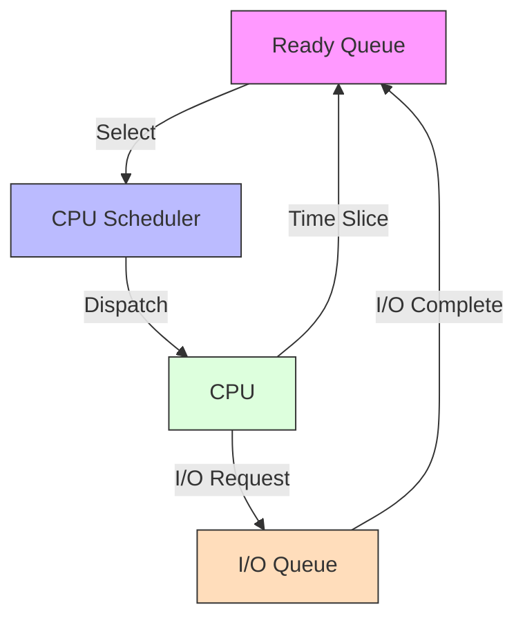
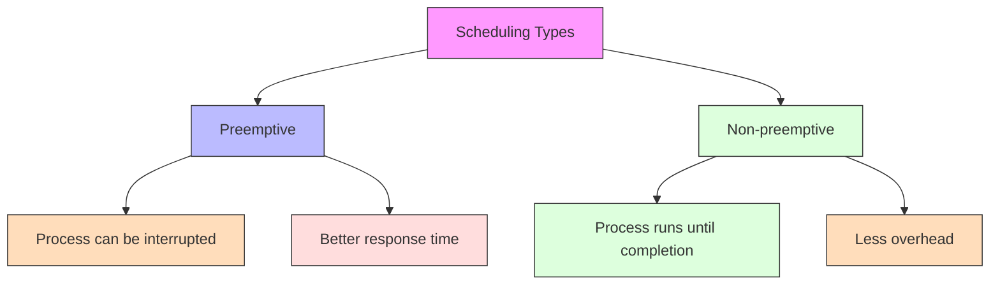
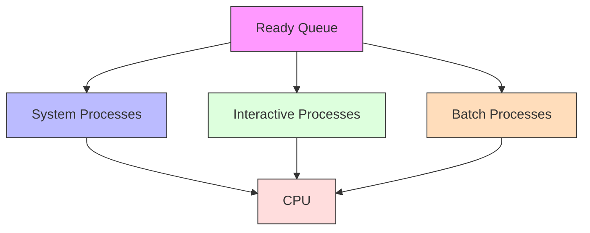
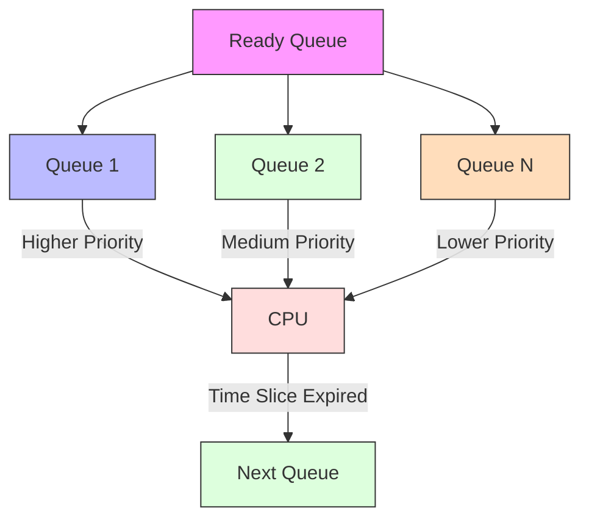
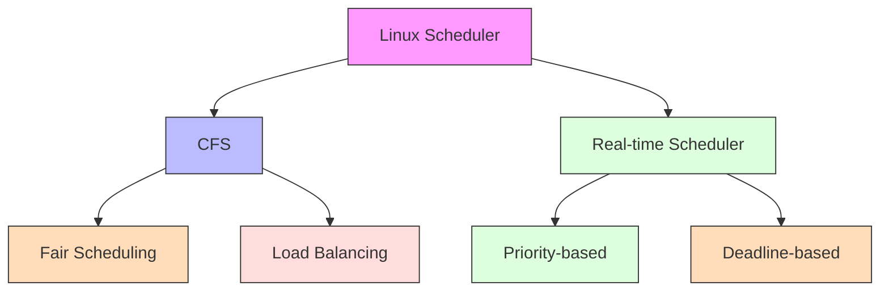
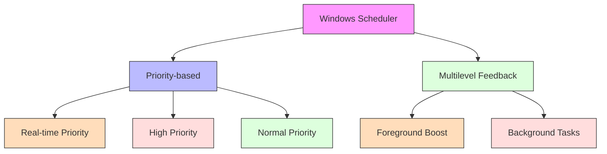

# CPU Scheduling

[Back to Course Content](README.md) | [Previous: Threads and Concurrency](threads-concurrency.md) | [Next: Synchronization Tools →](synchronization.md)

## What is CPU Scheduling?

CPU scheduling is the process of selecting which process should be executed next and allocating the CPU to it. The scheduler is the component of the operating system that makes this decision.

## Scheduling Concepts

### CPU-I/O Burst Cycle

### Preemptive vs Non-preemptive Scheduling

## Scheduling Algorithms

### First-Come, First-Served (FCFS)

```mermaid
gantt
    title FCFS Scheduling
    dateFormat  X
    axisFormat %s
    section Process
    P1    :a1, 0, 24
    P2    :a2, 24, 27
    P3    :a3, 27, 30
```

**Characteristics:**
- Non-preemptive
- Simple implementation
- Convoy effect
- Poor response time

### Shortest-Job-First (SJF)

```mermaid
gantt
    title SJF Scheduling
    dateFormat  X
    axisFormat %s
    section Process
    P2    :a1, 0, 3
    P3    :a2, 3, 6
    P1    :a3, 6, 30
```

**Characteristics:**
- Optimal average waiting time
- Difficult to predict burst time
- Starvation of long processes

### Priority Scheduling

```mermaid
gantt
    title Priority Scheduling
    dateFormat  X
    axisFormat %s
    section Process
    P1    :a1, 0, 10
    P2    :a2, 10, 15
    P3    :a3, 15, 20
```

**Characteristics:**
- Priority levels
- Starvation problem
- Aging solution

### Round Robin (RR)

```mermaid
gantt
    title Round Robin Scheduling
    dateFormat  X
    axisFormat %s
    section Process
    P1    :a1, 0, 4
    P2    :a2, 4, 8
    P3    :a3, 8, 12
    P1    :a4, 12, 16
    P2    :a5, 16, 20
    P3    :a6, 20, 24
```

**Characteristics:**
- Time quantum
- Fair scheduling
- Response time depends on quantum size

### Multilevel Queue Scheduling

### Multilevel Feedback Queue

## Performance Metrics

### CPU Utilization

### Throughput

### Turnaround Time

### Waiting Time

### Response Time

## Real-World Applications

### Linux Scheduler

### Windows Scheduler

## Performance Considerations

### Scheduling Overhead

### Optimization Techniques

1. **Efficient Data Structures**
   - Priority queues
   - Red-black trees
   - Hash tables

2. **Load Balancing**
   - Process migration
   - Queue balancing
   - Processor affinity

3. **Cache Optimization**
   - Cache-aware scheduling
   - NUMA-aware scheduling
   - Power-aware scheduling

## Summary

CPU scheduling is a crucial component of operating systems that determines which process gets to use the CPU and for how long. Different scheduling algorithms offer various trade-offs between fairness, response time, and throughput.

The choice of scheduling algorithm depends on the system's goals and requirements. Modern operating systems often use complex scheduling algorithms that combine multiple approaches to achieve optimal performance.

Understanding CPU scheduling is essential for both system programmers and application developers, as it affects application performance and system responsiveness.

## References and Further Reading

- Silberschatz, A., Galvin, P. B., & Gagne, G. (2018). *Operating System Concepts* (10th Edition). Wiley.
- Tanenbaum, A. S., & Bos, H. (2014). *Modern Operating Systems* (4th Edition). Pearson.
- Stevens, W. R., & Rago, S. A. (2013). *Advanced Programming in the UNIX Environment* (3rd Edition). Addison-Wesley.
- Bryant, R. E., & O'Hallaron, D. R. (2015). *Computer Systems: A Programmer's Perspective* (3rd Edition). Pearson.
- Love, R. (2013). *Linux System Programming* (2nd Edition). O'Reilly Media. 