# Deadlocks

[Back to Course Content](README.md) | [Previous: Synchronization Tools](synchronization.md) | [Next: Memory Management →](memory-management.md)

## What is a Deadlock?

A deadlock is a situation where a set of processes are blocked because each process is holding a resource and waiting for another resource acquired by some other process.

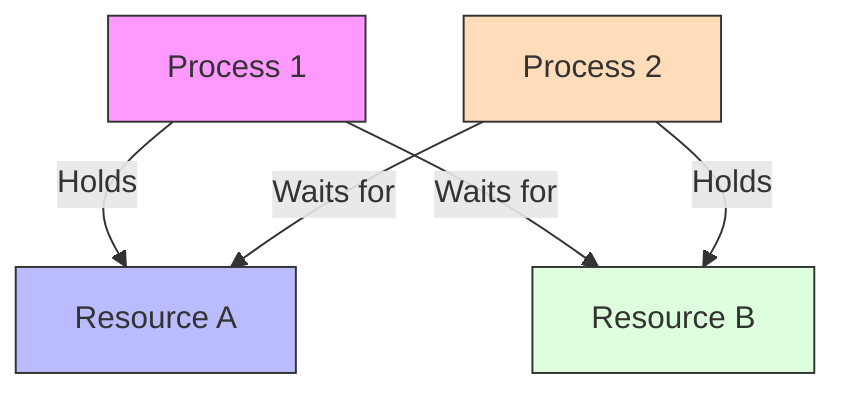

## Deadlock Characterization

### Necessary Conditions

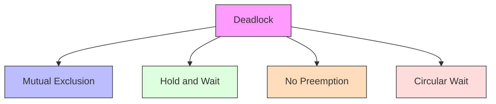

### Resource Allocation Graph

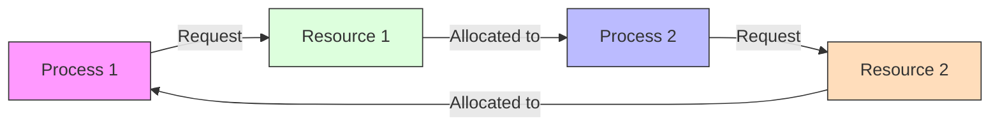

## Deadlock Prevention

### Prevention Methods

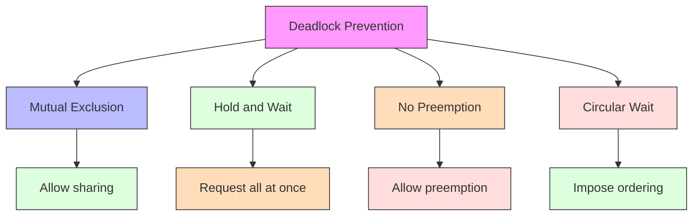

### Resource Ordering

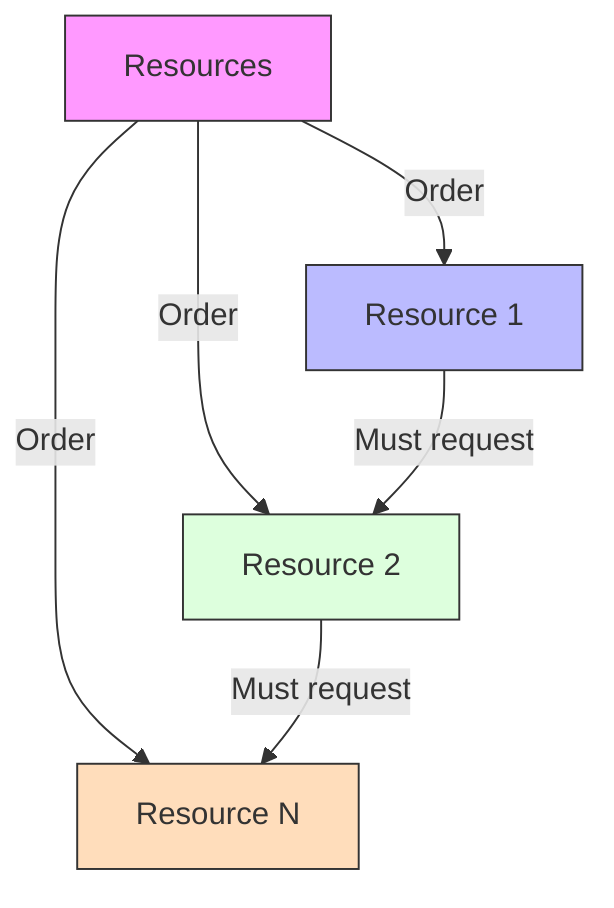

## Deadlock Avoidance

### Safe State

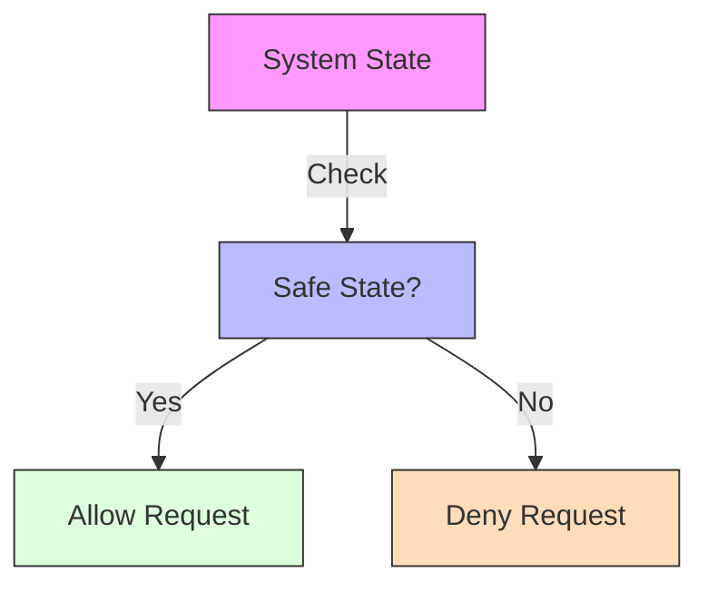

### Banker's Algorithm

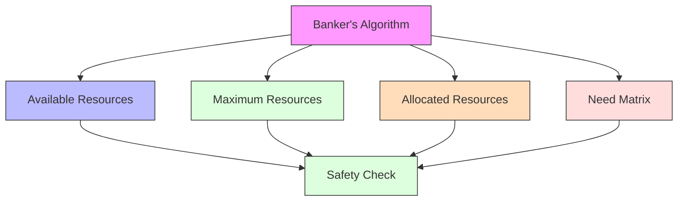

## Deadlock Detection

### Detection Algorithm

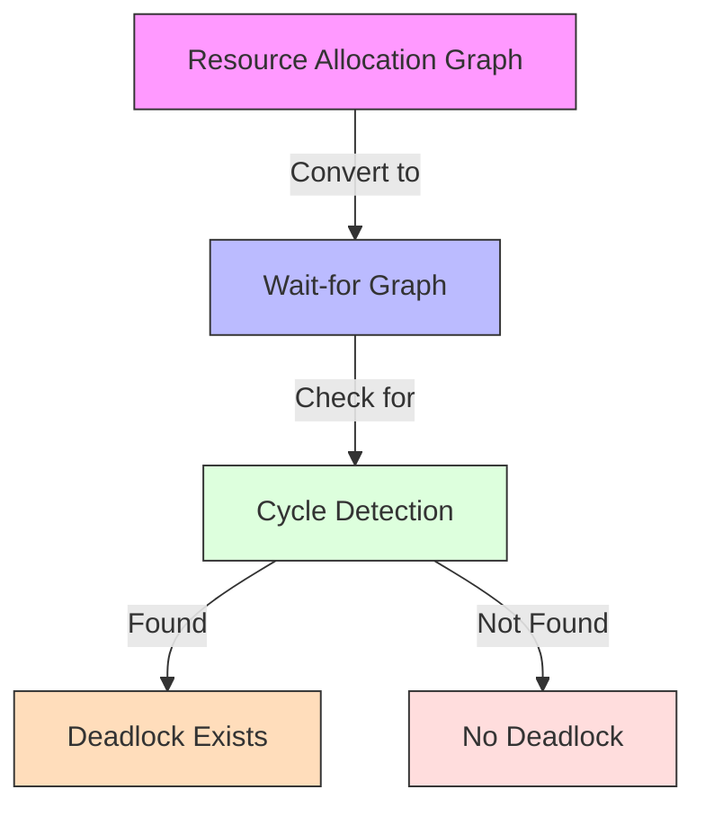

### Wait-for Graph

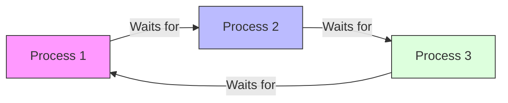

## Deadlock Recovery

### Recovery Methods

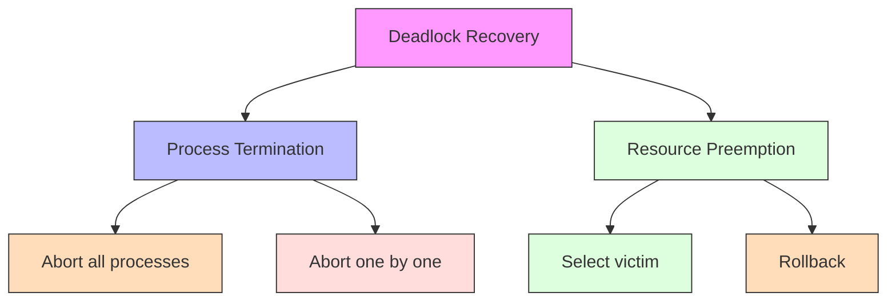

### Victim Selection

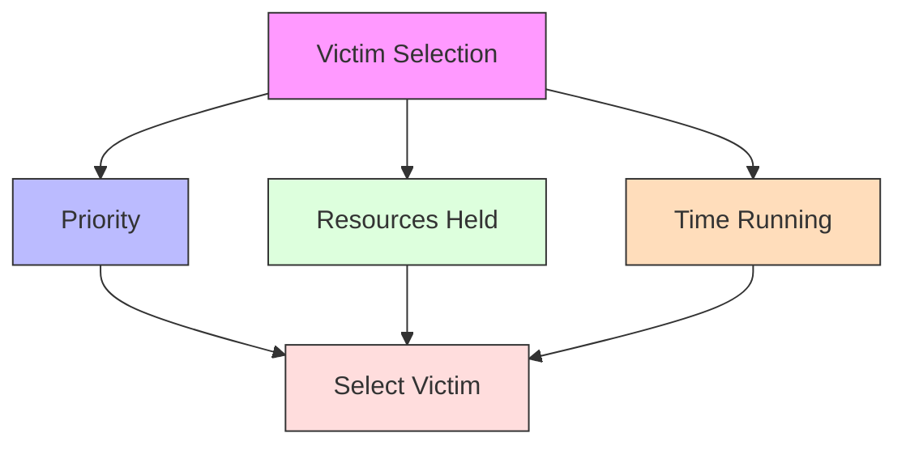

## Real-World Applications

### Database Systems

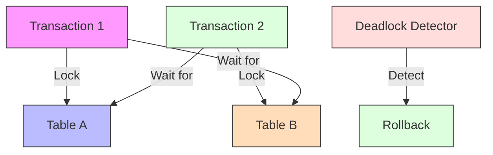

### Operating Systems

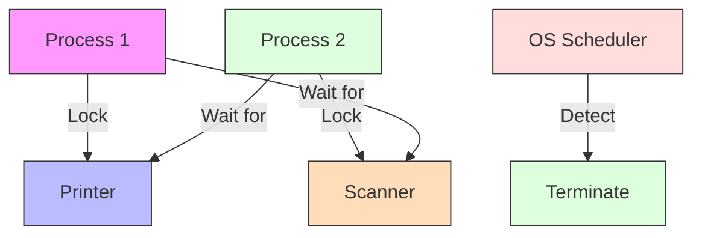

## Performance Considerations

### Detection Overhead

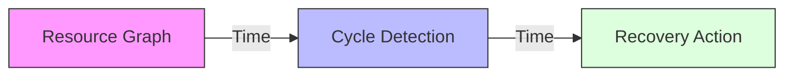

### Optimization Techniques

1. **Efficient Detection**
   - Periodic checking
   - Incremental updates
   - Parallel detection

2. **Smart Recovery**
   - Minimal impact
   - Cost-based selection
   - State preservation

3. **Prevention Strategies**
   - Resource ordering
   - Timeout mechanisms
   - Resource limits

## Summary

Deadlocks are a serious problem in concurrent systems that can lead to system-wide failures. Understanding the necessary conditions for deadlocks and various prevention, avoidance, detection, and recovery methods is crucial for system design.

Different approaches offer various trade-offs between system performance and deadlock handling. The choice of method depends on the system's requirements and constraints.

Proper deadlock handling is essential for maintaining system reliability and performance.

## References and Further Reading

- Silberschatz, A., Galvin, P. B., & Gagne, G. (2018). *Operating System Concepts* (10th Edition). Wiley.
- Tanenbaum, A. S., & Bos, H. (2014). *Modern Operating Systems* (4th Edition). Pearson.
- Stevens, W. R., & Rago, S. A. (2013). *Advanced Programming in the UNIX Environment* (3rd Edition). Addison-Wesley.
- Bryant, R. E., & O'Hallaron, D. R. (2015). *Computer Systems: A Programmer's Perspective* (3rd Edition). Pearson.
- Love, R. (2013). *Linux System Programming* (2nd Edition). O'Reilly Media. 