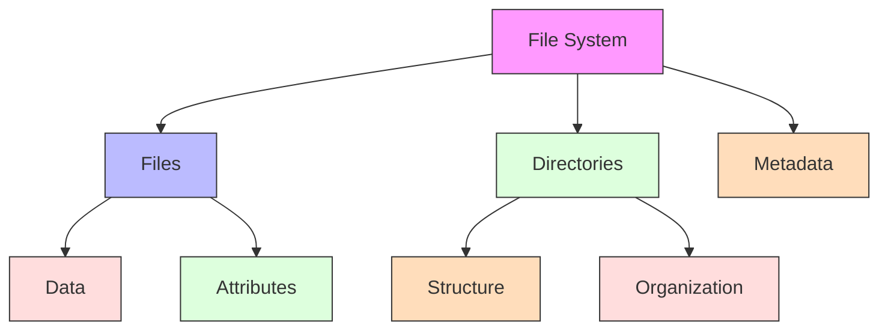
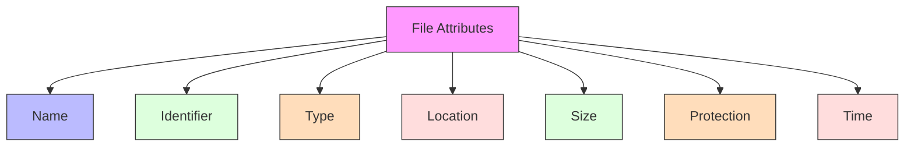
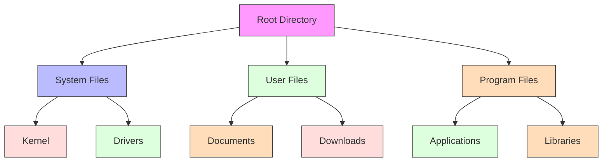
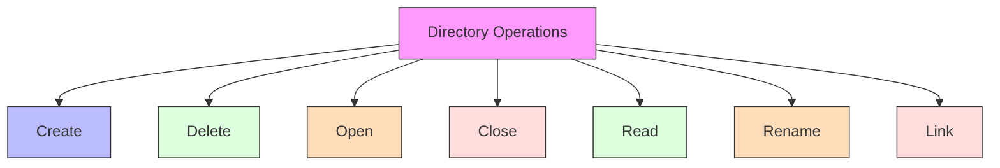
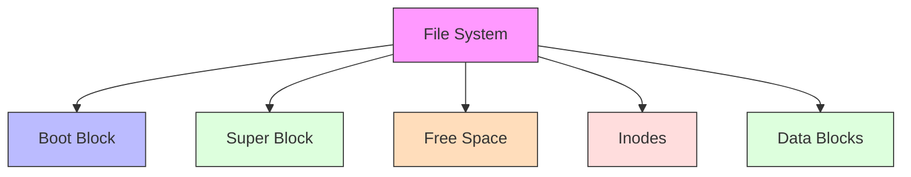
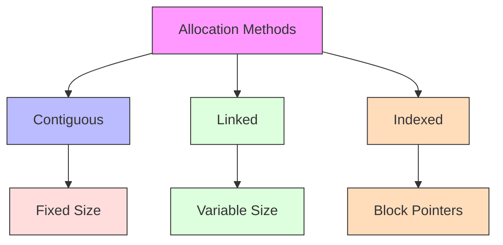
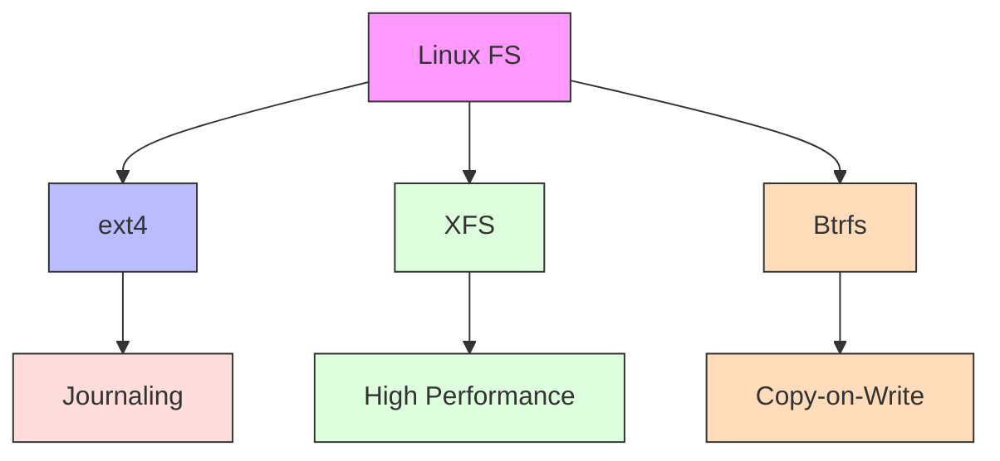
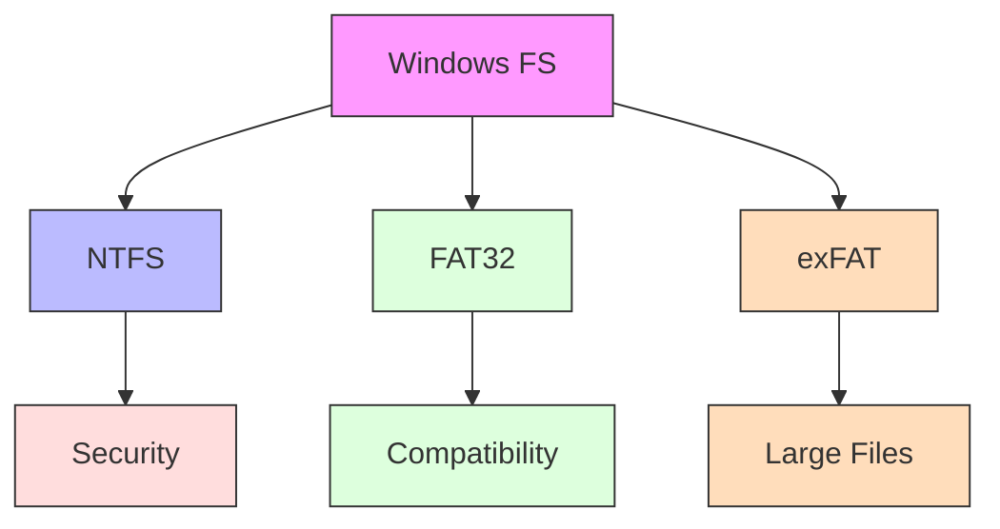
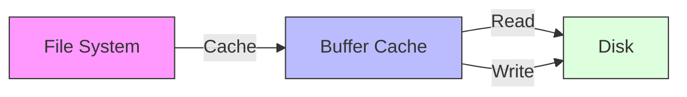

# File Systems

[Back to Course Content](README.md) | [Previous: Memory Management](memory-management.md) | [Next: I/O Systems →](io-systems.md)

## What is a File System?

A file system is a method for storing and organizing computer files and the data they contain to make it easy to find and access them.

## File Concepts

### File Attributes

### File Operations

## Directory Structure

### Directory Organization

### Directory Operations

## File System Implementation

### File System Layout

### File Allocation Methods

## Real-World Applications

### Linux File Systems

### Windows File Systems

## Performance Considerations

### File System Caching

### Optimization Techniques

1. **Block Size Selection**
   - Trade-off between space efficiency and access time
   - Common sizes: 4KB, 8KB, 16KB

2. **Caching Strategies**
   - Buffer cache
   - Page cache
   - Directory cache

3. **Disk Scheduling**
   - Elevator algorithm
   - Deadline scheduling
   - Anticipatory scheduling

## Summary

File systems are essential components of operating systems that provide organized storage and access to data. Understanding file system concepts, implementation details, and performance considerations is crucial for system design and optimization.

The choice of file system and its configuration depends on various factors including storage requirements, performance needs, and compatibility requirements.

## References and Further Reading

- Silberschatz, A., Galvin, P. B., & Gagne, G. (2018). *Operating System Concepts* (10th Edition). Wiley.
- Tanenbaum, A. S., & Bos, H. (2014). *Modern Operating Systems* (4th Edition). Pearson.
- Stevens, W. R., & Rago, S. A. (2013). *Advanced Programming in the UNIX Environment* (3rd Edition). Addison-Wesley.
- Bryant, R. E., & O'Hallaron, D. R. (2015). *Computer Systems: A Programmer's Perspective* (3rd Edition). Pearson.
- Love, R. (2013). *Linux System Programming* (2nd Edition). O'Reilly Media. 