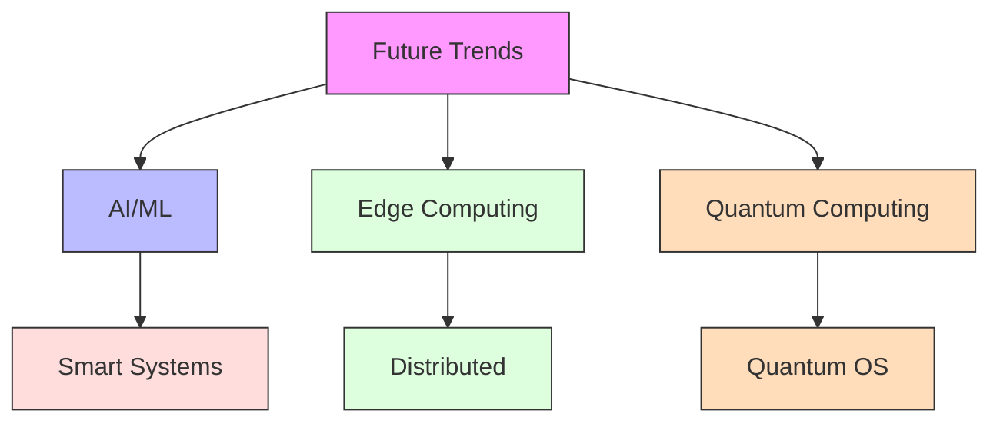
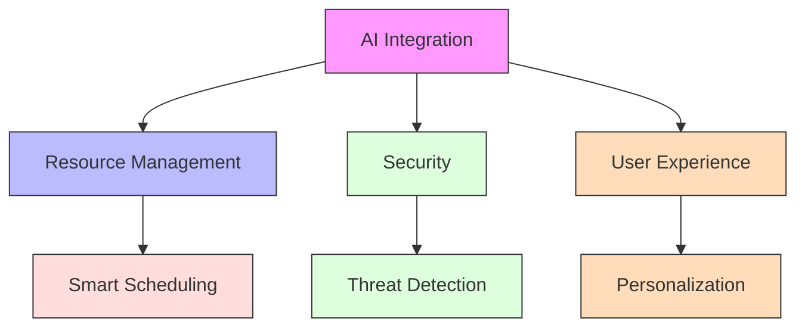
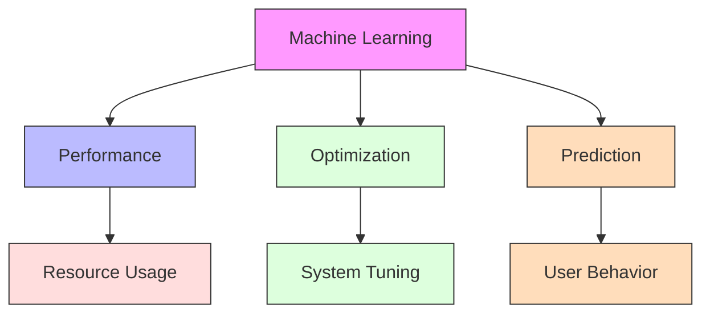
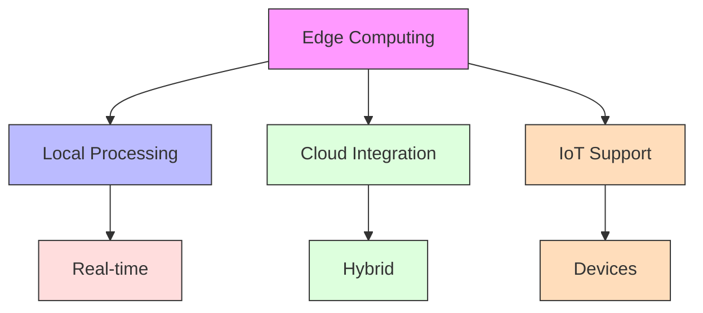
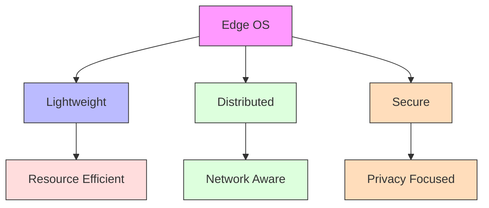
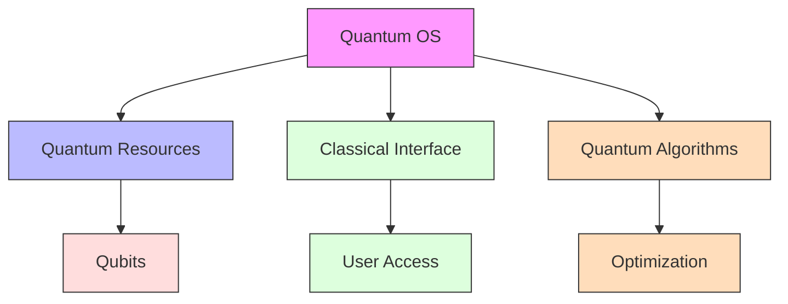
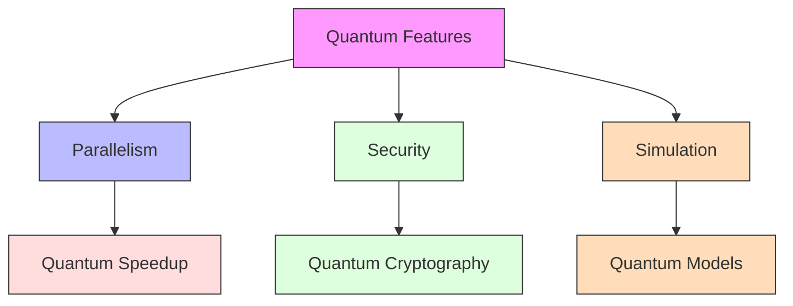
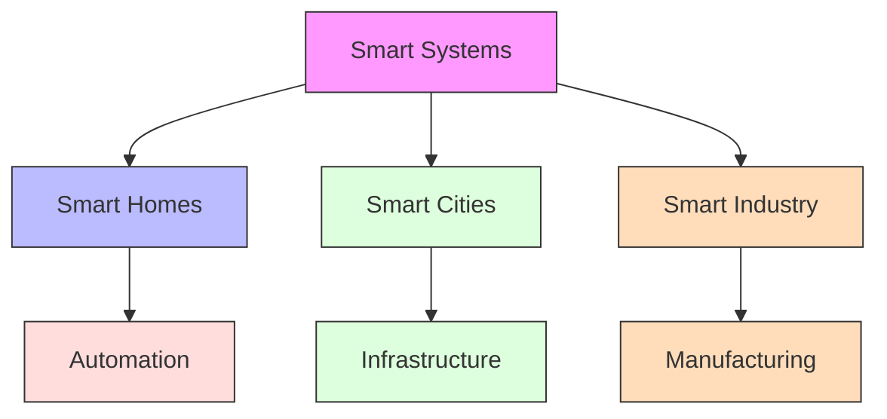
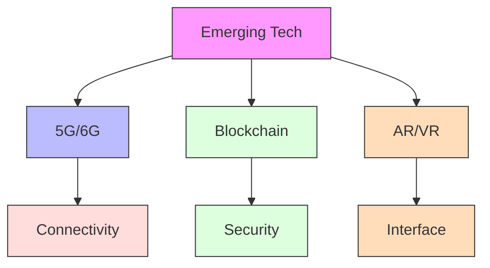
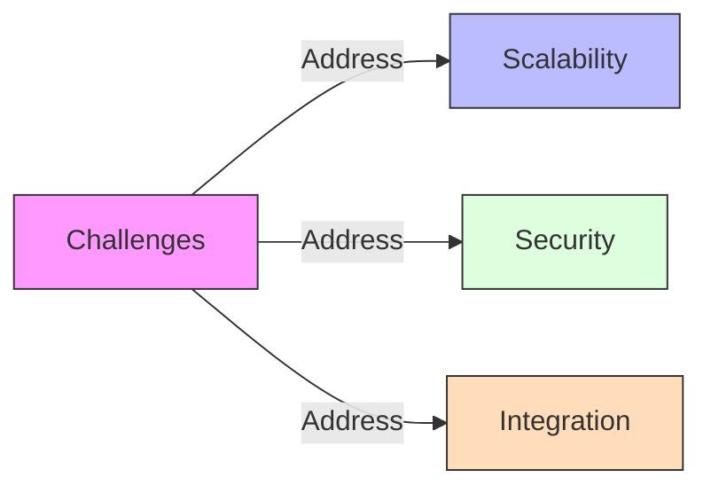

# Future Trends

[Back to Course Content](README.md) | [Previous: Case Studies](case-studies.md) | [Next: Conclusion →](conclusion.md)

## What are Future Trends?

Future trends in operating systems explore emerging technologies and potential developments that may shape the future of computing.

## Artificial Intelligence

### AI Integration

### Machine Learning

## Edge Computing

### Edge Architecture

### Edge OS Features

## Quantum Computing

### Quantum OS

### Quantum Features

## Real-World Applications

### Smart Systems

### Emerging Technologies

## Challenges and Opportunities

### Technical Challenges

### Future Opportunities

1. **Research Areas**
   - Quantum computing
   - AI integration
   - Edge computing

2. **Industry Impact**
   - Smart systems
   - IoT devices
   - Cloud services

3. **User Experience**
   - Personalization
   - Automation
   - Accessibility

## Summary

Future trends in operating systems are shaped by emerging technologies and evolving user needs. Understanding these trends helps in preparing for future developments and challenges in computing.

The integration of AI, edge computing, and quantum computing presents both opportunities and challenges for operating system design and implementation.

## References and Further Reading

- Silberschatz, A., Galvin, P. B., & Gagne, G. (2018). *Operating System Concepts* (10th Edition). Wiley.
- Tanenbaum, A. S., & Bos, H. (2014). *Modern Operating Systems* (4th Edition). Pearson.
- Stevens, W. R., & Rago, S. A. (2013). *Advanced Programming in the UNIX Environment* (3rd Edition). Addison-Wesley.
- Bryant, R. E., & O'Hallaron, D. R. (2015). *Computer Systems: A Programmer's Perspective* (3rd Edition). Pearson.
- Love, R. (2013). *Linux System Programming* (2nd Edition). O'Reilly Media. 