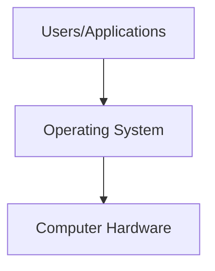
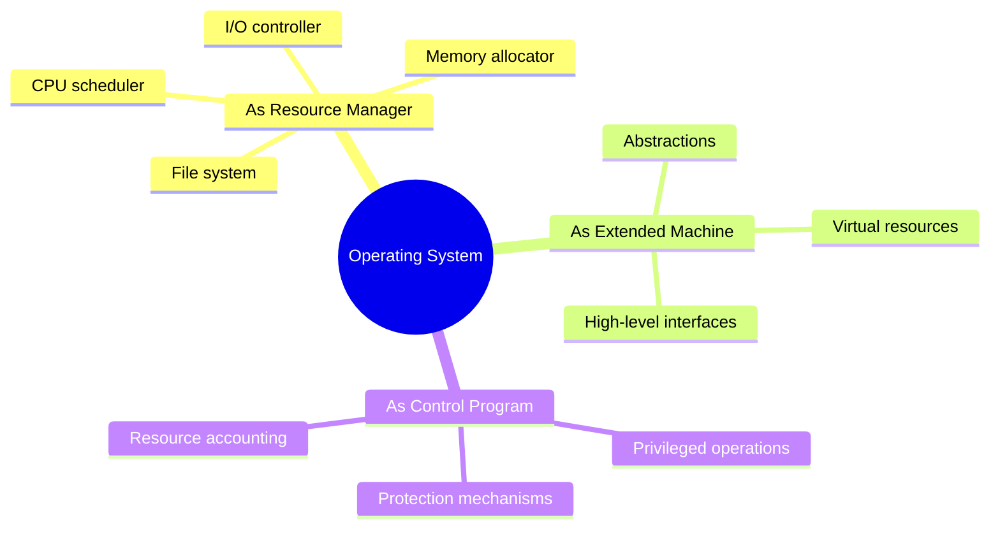
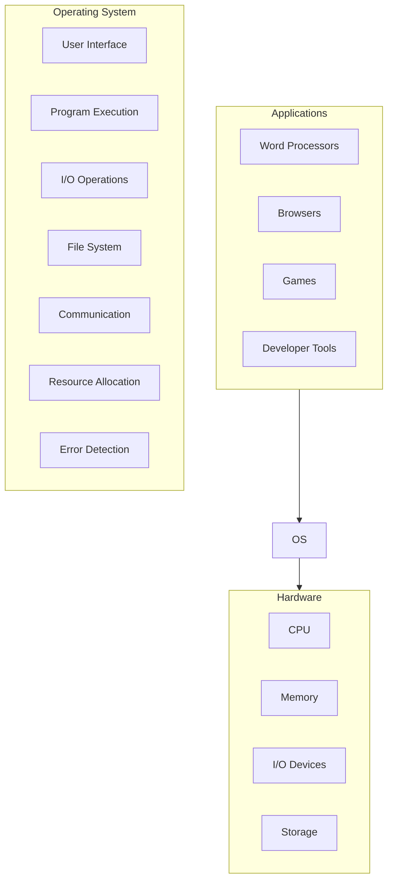
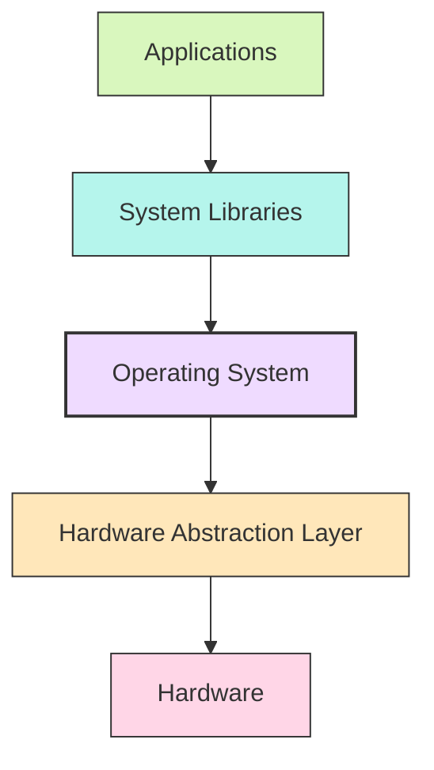
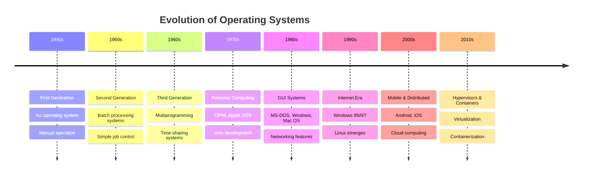
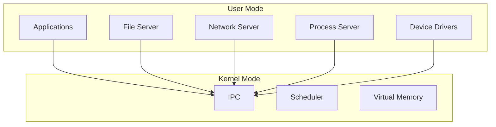

# Introduction to Operating Systems

[Back to Course Content](README.md) | [Next: Operating System Services →](os-services.md)

## What is an Operating System?

An Operating System (OS) is a well-organized collection of software that manages computer hardware and provides an environment for applications to run. It acts as an intermediary between users and the computer hardware, coordinating the use of resources among multiple applications and users.

### Core Definition and Functions

The operating system performs these essential functions:
- **Resource Management**: Allocates CPU time, memory, storage, and I/O devices efficiently
- **Interface Provision**: Provides abstractions and APIs for applications to interact with hardware
- **Process Management**: Creates, schedules, and terminates processes and threads
- **Memory Management**: Allocates and deallocates memory space for programs
- **File System Management**: Controls file operations, organization, and access methods
- **I/O Management**: Handles input/output operations between the system and external devices
- **Security and Protection**: Protects system resources and user data from unauthorized access

### Operating System Perspectives

### Major Operating Systems

| Operating System | Platform | Market Segment | Key Features |
|------------------|----------|----------------|--------------|
| **Windows** | PC, Server | Desktop, Enterprise | User-friendly GUI, extensive software compatibility |
| **macOS** | Apple hardware | Desktop, Creative professionals | Elegant interface, integration with Apple ecosystem |
| **Linux** | PC, Server, Embedded | Servers, Development, IoT | Open-source, customizable, powerful CLI |
| **Android** | Mobile, Tablets | Consumer devices | Mobile-optimized, app-centric, Java-based |
| **iOS** | iPhone, iPad | Consumer devices | Optimized for touch, security-focused |
| **Unix** | Servers | Enterprise, Academic | Multi-user, stable, network-oriented |

## Computer System Structure

Modern computer systems consist of multiple layers of hardware and software, with the operating system being the crucial layer between applications and hardware.

### Hardware Components

1. **Central Processing Unit (CPU)**
   - Executes instructions, performs calculations
   - Contains Control Unit, ALU, registers
   - Modern CPUs often have multiple cores

2. **Memory Hierarchy**
   - Registers: Fastest, smallest, inside CPU
   - Cache: Very fast, small, expensive
   - Main Memory (RAM): Volatile, moderate speed
   - Secondary Storage: Non-volatile, slower, larger

3. **I/O Devices**
   - Input devices: Keyboard, mouse, touchscreen
   - Output devices: Monitor, printer, speakers
   - Storage devices: Hard drives, SSDs, USB drives
   - Network devices: Ethernet cards, Wi-Fi adapters

4. **System Bus**
   - Connects various hardware components
   - Transfers data, addresses, and control signals

### Software Layers

## Operating System Roles

### Referee

The OS arbitrates competing demands for resources:
- Allocates CPU time to multiple processes
- Manages memory space for applications
- Controls access to I/O devices
- Prevents programs from interfering with each other

### Illusionist

The OS creates useful abstractions of hardware:
- Presents a virtual machine interface that is easier to use than raw hardware
- Creates the illusion of unlimited memory through virtual memory
- Provides file systems instead of raw disk blocks
- Abstracts network communications into sockets and streams

### Glue

The OS provides common services for applications:
- Standard interfaces for device access
- Networking protocols and services
- User interface components
- Security mechanisms

## Evolution of Operating Systems

### Historical Progression

1. **Serial Processing (1940s-1950s)**
   - No operating system
   - Manual setup for each program
   - Inefficient machine utilization

2. **Simple Batch Systems (1950s-early 1960s)**
   - Grouped similar jobs into batches
   - Introduced job control language
   - Improved throughput but poor response time

3. **Multiprogrammed Batch Systems (1960s)**
   - Multiple programs loaded in memory
   - CPU switched between programs
   - Better resource utilization

4. **Time-Sharing Systems (1960s-1970s)**
   - Interactive computing
   - Multiple users simultaneously
   - Quick response time

5. **Personal Computing (1970s-1980s)**
   - Single-user focus
   - Emphasis on ease of use
   - Limited multitasking initially

6. **Networked Operating Systems (1980s-1990s)**
   - Connected individual computers
   - Shared resources across networks
   - Client-server computing

7. **Distributed Systems (1990s-2000s)**
   - Transparent access to resources across network
   - Location independence
   - Fault tolerance and scalability

8. **Mobile Operating Systems (2000s-present)**
   - Power-efficient designs
   - Touch-optimized interfaces
   - App-centric models

9. **Cloud and Virtualization (2010s-present)**
   - Hypervisors managing multiple OS instances
   - Container technologies
   - Infrastructure as a service

## Operating System Architectures

### Monolithic Systems

All OS services run in kernel mode as a single program:

**Advantages:**
- Efficient communication between OS components
- Direct hardware access for all OS functions

**Disadvantages:**
- Large codebase is difficult to maintain
- Bugs in any part can crash the entire system
- Limited extensibility

**Example:** Traditional Unix, Linux kernel

### Layered Approach

OS is divided into hierarchical layers, each building on the layer below:

**Advantages:**
- Simplifies debugging and system verification
- Each layer uses only lower-level functions
- Modular design

**Disadvantages:**
- Less efficient due to additional function calls
- Defining clean layers is challenging

**Example:** THE operating system (historical)

### Microkernel Architecture

Minimal kernel with services as user processes:

**Advantages:**
- Enhanced reliability (service crashes don't bring down the system)
- Easier to extend and modify
- More secure due to reduced kernel code

**Disadvantages:**
- Performance overhead from IPC
- Complex coordination between services

**Example:** MINIX, QNX, macOS/Darwin (partially)

### Hybrid Systems

Combine elements of monolithic and microkernel approaches:

**Advantages:**
- Balance between performance and modularity
- Practical approach for modern systems

**Disadvantages:**
- Can inherit drawbacks of both approaches
- More complex design

**Example:** Windows NT architecture, macOS

## Real-World Applications and Case Studies

### Windows Operating System

**Evolution:**
- Started as MS-DOS (text-based)
- Windows 1.0-3.11 (GUI shell over DOS)
- Windows 95/98/ME (consumer line)
- Windows NT/2000/XP/Vista/7/8/10/11 (NT kernel line)

**Architecture:**
- Hybrid design with microkernel influences
- Hardware Abstraction Layer (HAL)
- Executive services in kernel mode
- Subsystems in user mode

**Market Impact:**
- Dominates desktop/laptop market (~75%)
- Strong enterprise presence
- Gaming platform

### Linux Operating System

**Evolution:**
- Created by Linus Torvalds in 1991
- Inspired by UNIX and MINIX
- Rapidly developed through open-source collaboration

**Architecture:**
- Monolithic kernel with loadable modules
- Everything runs in kernel space or user space
- Modular design allowing for customization

**Market Impact:**
- Powers majority of web servers (~70%)
- Android uses Linux kernel
- Dominates supercomputing (~100%)
- Embedded systems and IoT devices

### macOS Operating System

**Evolution:**
- Based on NeXTSTEP, acquired when Apple bought NeXT
- macOS X (10.0) released in 2001
- Regular releases with both major and minor updates

**Architecture:**
- Hybrid architecture with microkernel (Mach) and BSD subsystems
- Darwin is the open-source core of macOS
- Aqua GUI and proprietary applications

**Market Impact:**
- ~15-20% of desktop/laptop market
- Popular among creative professionals
- Tight integration with Apple hardware ecosystem

## Benefits and Limitations of Operating Systems

### Benefits

1. **Resource Abstraction**: Simplifies application development by providing high-level interfaces
2. **Resource Sharing**: Allows multiple applications to share hardware efficiently
3. **Protection**: Prevents applications from interfering with each other
4. **Reliability**: Provides stable environment for running applications
5. **Performance**: Optimizes hardware utilization
6. **Scalability**: Adapts to changing hardware and user needs

### Limitations

1. **Overhead**: OS consumes system resources that could be used by applications
2. **Complexity**: Modern OS are extremely complex, making them difficult to maintain
3. **Security Vulnerabilities**: Large codebase creates potential security issues
4. **Compatibility Issues**: Changes can break existing applications
5. **Performance Tradeoffs**: General-purpose design may not be optimal for specific workloads

## Importance of Operating Systems Study

Understanding operating systems is crucial for:

1. **Software Development**: Knowing how the OS works helps build more efficient applications
2. **System Administration**: Effective management of computer systems requires OS knowledge
3. **Security Analysis**: Many security issues involve OS vulnerabilities
4. **Performance Optimization**: Tuning systems for maximum performance
5. **Hardware Design**: Creating hardware that interfaces well with operating systems
6. **Future Innovation**: Developing new computing paradigms and systems

## Summary

Operating systems are the crucial software layer that manages computer hardware and provides services to applications. They have evolved from simple batch processing systems to complex, multi-faceted platforms that support a wide range of devices and use cases.

Understanding operating systems involves studying their components, architectures, functions, and interactions. This knowledge forms the foundation for almost all aspects of computing, from software development to system administration.

Modern operating systems continue to evolve to address new challenges in areas such as cloud computing, virtualization, mobility, and security while maintaining their core role as the essential intermediary between hardware and software.

## References and Further Reading

- Silberschatz, A., Galvin, P. B., & Gagne, G. (2018). *Operating System Concepts* (10th Edition). Wiley.
- Tanenbaum, A. S., & Bos, H. (2014). *Modern Operating Systems* (4th Edition). Pearson.
- Stallings, W. (2017). *Operating Systems: Internals and Design Principles* (9th Edition). Pearson.
- Shaw, A. C. (2003). *Real-Time Systems and Software*. Wiley.
- Love, R. (2013). *Linux Kernel Development* (3rd Edition). Addison-Wesley. 