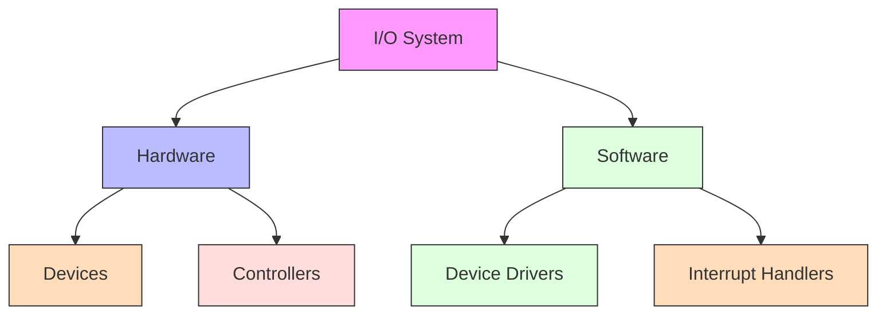
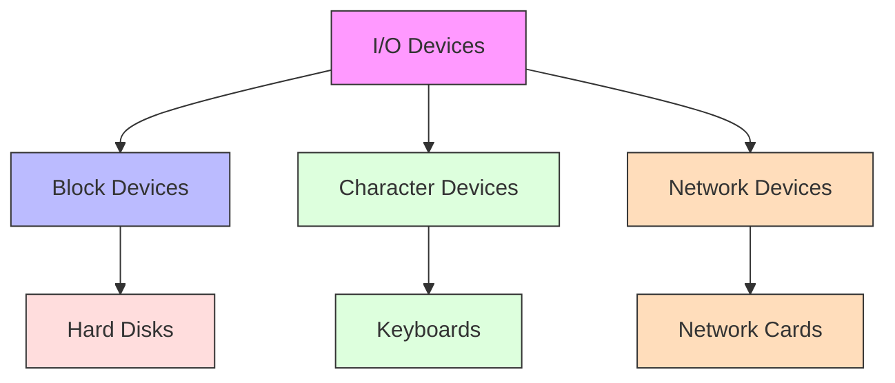
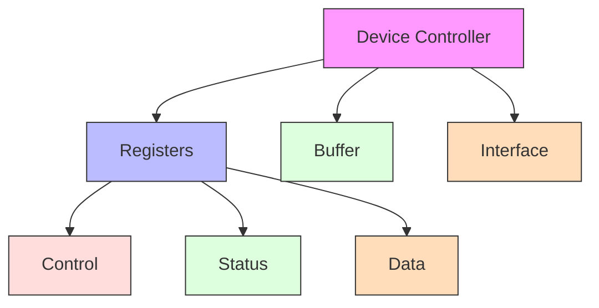
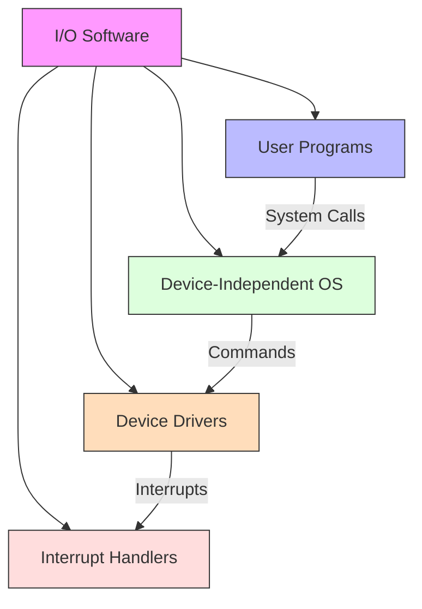
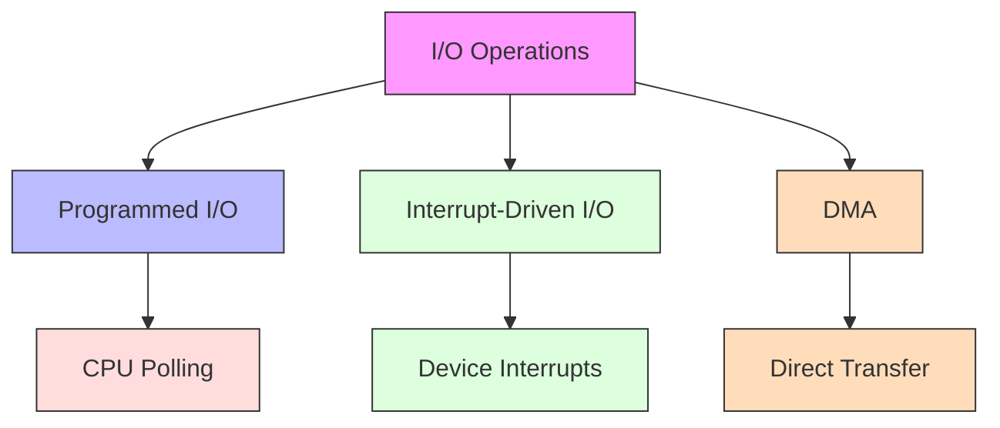
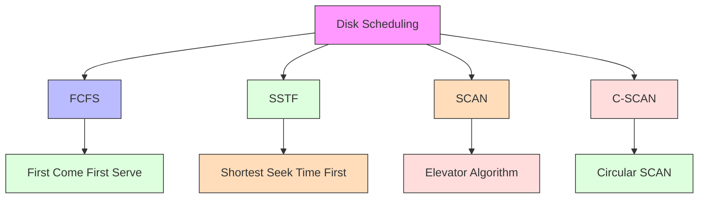
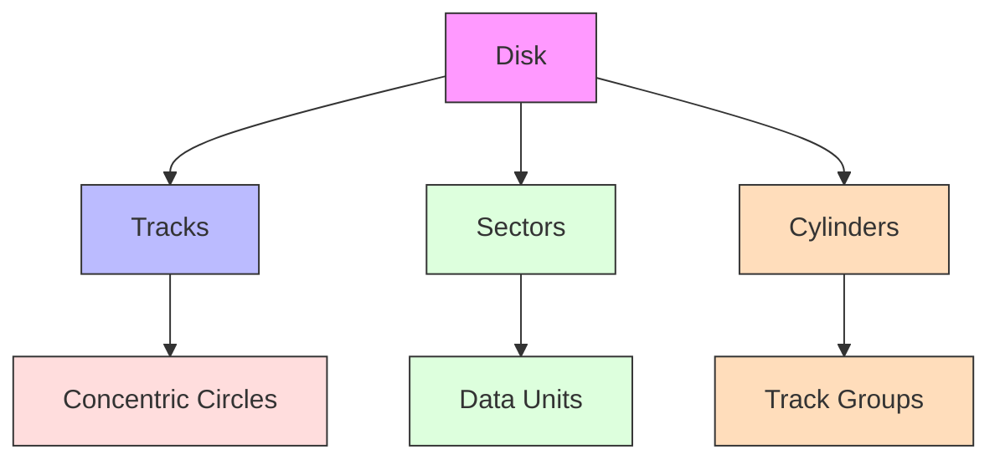
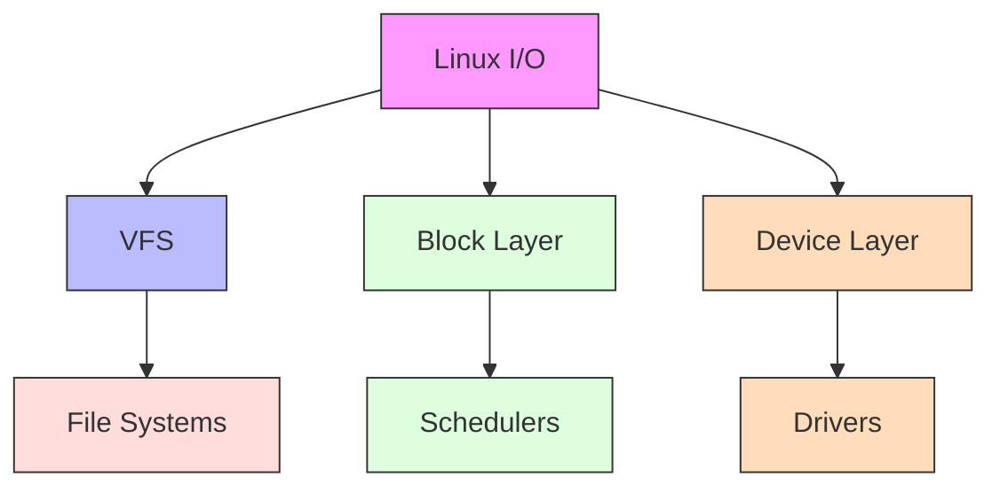
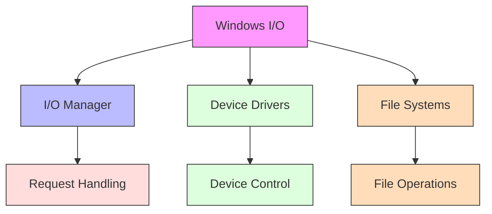
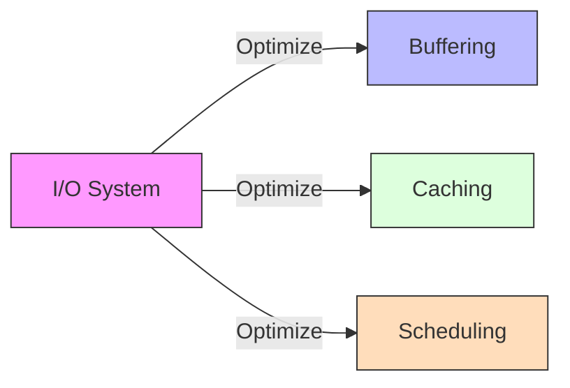

# I/O Systems

[Back to Course Content](README.md) | [Previous: File Systems](file-systems.md) | [Next: Security →](security.md)

## What is an I/O System?

An I/O system manages the communication between a computer and its peripheral devices, handling data transfer and device control.

## I/O Hardware

### Device Types

### Device Controllers

## I/O Software

### I/O Software Layers

### I/O Operations

## Disk Scheduling

### Scheduling Algorithms

### Disk Structure

## Real-World Applications

### Linux I/O System

### Windows I/O System

## Performance Considerations

### I/O Optimization

### Optimization Techniques

1. **Buffering**
   - Single buffering
   - Double buffering
   - Circular buffering

2. **Caching**
   - Device cache
   - Buffer cache
   - Page cache

3. **Scheduling**
   - Disk scheduling
   - I/O scheduling
   - Priority scheduling

## Summary

I/O systems are crucial components of operating systems that manage communication between the computer and its peripheral devices. Understanding I/O hardware, software layers, and optimization techniques is essential for system design and performance.

The choice of I/O methods and scheduling algorithms depends on various factors including device characteristics, performance requirements, and system constraints.

## References and Further Reading

- Silberschatz, A., Galvin, P. B., & Gagne, G. (2018). *Operating System Concepts* (10th Edition). Wiley.
- Tanenbaum, A. S., & Bos, H. (2014). *Modern Operating Systems* (4th Edition). Pearson.
- Stevens, W. R., & Rago, S. A. (2013). *Advanced Programming in the UNIX Environment* (3rd Edition). Addison-Wesley.
- Bryant, R. E., & O'Hallaron, D. R. (2015). *Computer Systems: A Programmer's Perspective* (3rd Edition). Pearson.
- Love, R. (2013). *Linux System Programming* (2nd Edition). O'Reilly Media. 