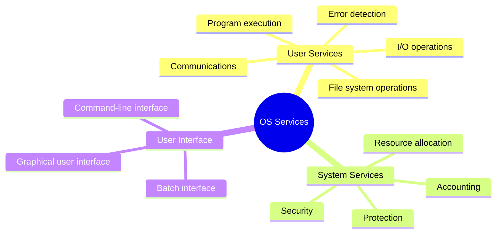
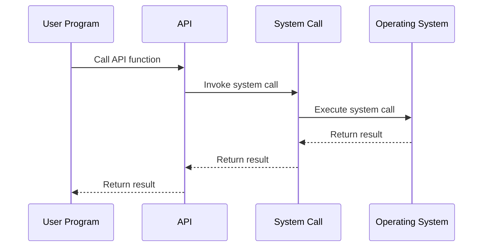
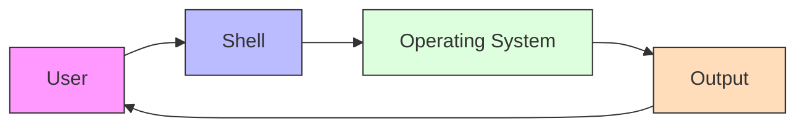
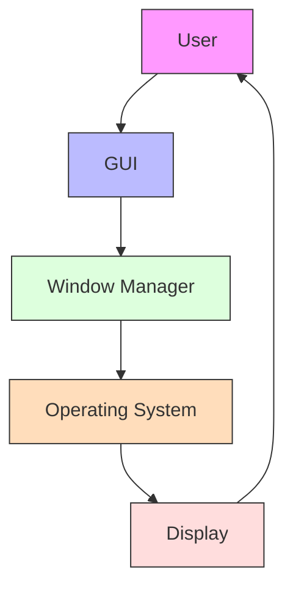
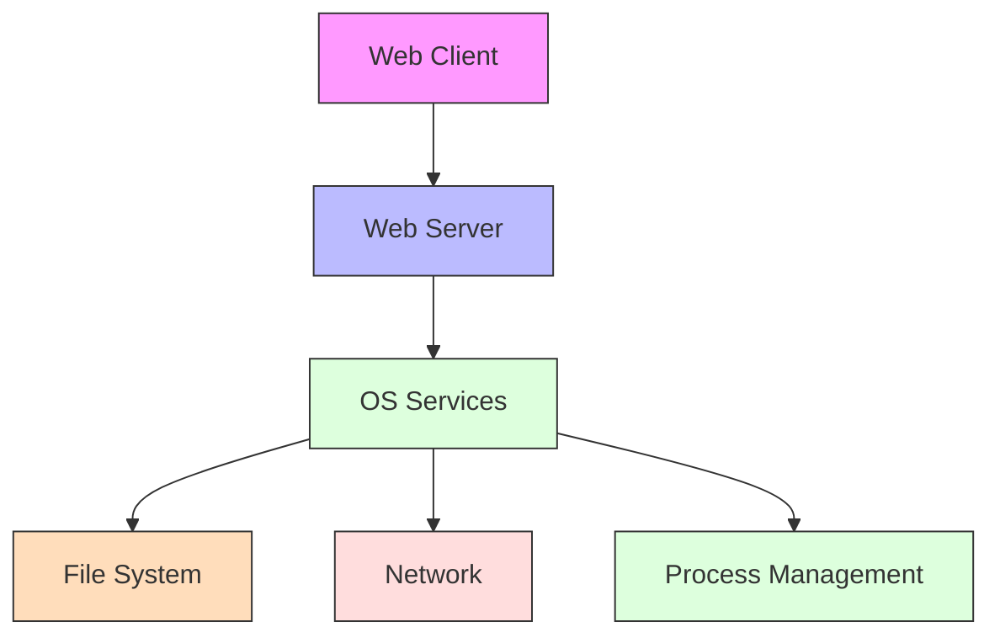
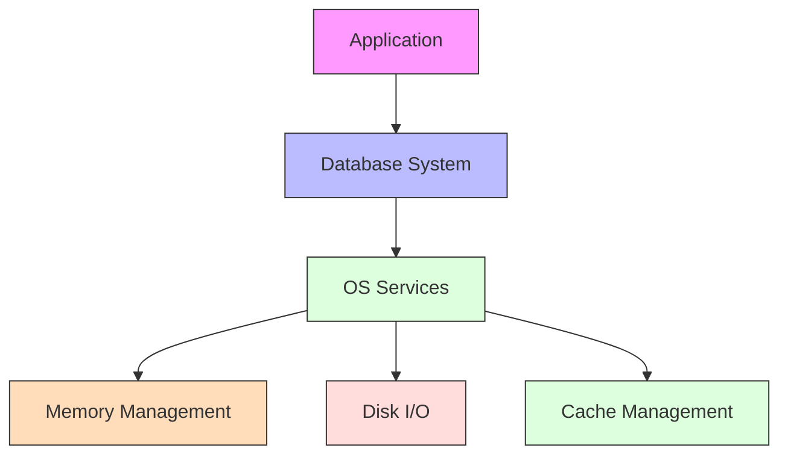
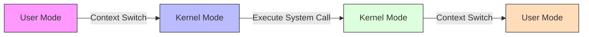
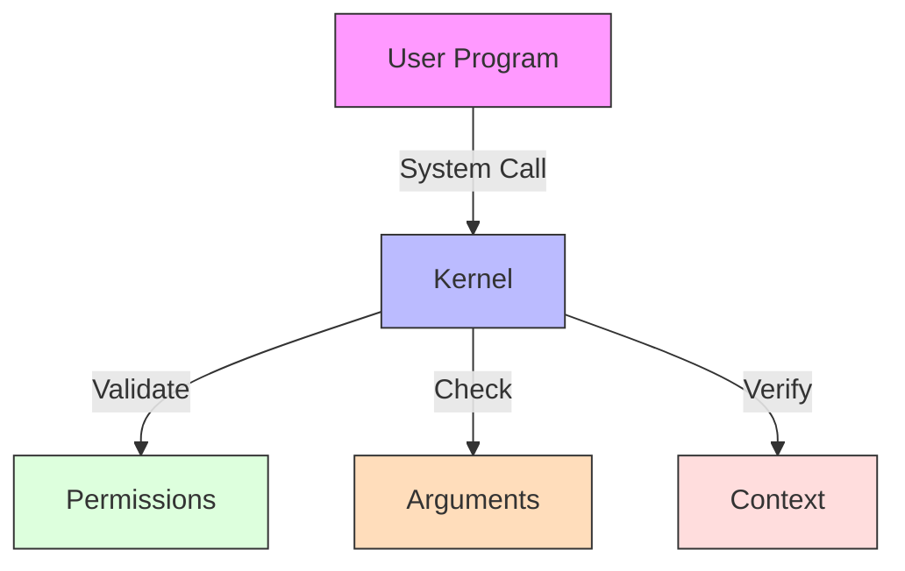

# Operating System Services

[Back to Course Content](README.md) | [Previous: Introduction](introduction.md) | [Next: Processes →](processes.md)

## What are Operating System Services?

Operating System Services are the fundamental functions provided by an operating system to support the execution of user programs and ensure efficient system operation. These services form the interface between user programs and the operating system.



## Types of Operating System Services

### User Services

These services are designed to make the programming task easier:

1. **Program Execution**
   - Load program into memory
   - Run the program
   - End execution, either normally or abnormally

2. **I/O Operations**
   - Read/write files
   - Access I/O devices
   - Handle device-specific operations

3. **File System Operations**
   - Create/delete files
   - Read/write files
   - Search directories
   - List directory contents
   - Manage file permissions

4. **Communications**
   - Message passing between processes
   - Shared memory between processes
   - Network communications

5. **Error Detection**
   - Hardware errors
   - Memory errors
   - I/O errors
   - Program errors

### System Services

These services ensure efficient system operation:

1. **Resource Allocation**
   - CPU scheduling
   - Memory management
   - I/O device management
   - Storage management

2. **Accounting**
   - Track resource usage
   - Monitor system performance
   - Generate usage statistics

3. **Protection and Security**
   - Access control
   - User authentication
   - Data encryption
   - Firewall services

## System Calls

System calls provide the interface between a running program and the operating system.

### Types of System Calls

```mermaid
graph TD
    A[System Calls] --> B[Process Control]
    A --> C[File Management]
    A --> D[Device Management]
    A --> E[Information Maintenance]
    A --> F[Communications]
    A --> G[Protection]
    
    B --> B1[End/Abort]
    B --> B2[Load/Execute]
    B --> B3[Create/End Process]
    
    C --> C1[Create/Delete File]
    C --> C2[Open/Close File]
    C --> C3[Read/Write File]
    
    D --> D1[Request/Release Device]
    D --> D2[Read/Write Device]
    D --> D3[Get/Set Device Attributes]
    
    E --> E1[Get/Set Time/Date]
    E --> E2[Get/Set System Data]
    E --> E3[Get/Set Process/File Attributes]
    
    F --> F1[Create/Delete Connection]
    F --> F2[Send/Receive Messages]
    F --> F3[Transfer Status Information]
    
    G --> G1[Get/Set Permissions]
    G --> G2[Allow/Deny Access]
    G --> G3[Set/Get Security Attributes]
```



### System Call Implementation



### Example System Calls

| Category | System Call | Description | Example Usage |
|----------|-------------|-------------|---------------|
| Process Control | `fork()` | Create new process | `pid = fork();` |
| File Management | `open()` | Open file | `fd = open("file.txt", O_RDWR);` |
| Device Management | `ioctl()` | Control device | `ioctl(fd, SET_BAUD_RATE, 9600);` |
| Information | `getpid()` | Get process ID | `pid = getpid();` |
| Communication | `socket()` | Create socket | `sock = socket(AF_INET, SOCK_STREAM, 0);` |
| Protection | `chmod()` | Change file permissions | `chmod("file.txt", 0644);` |

## Application Programming Interface (API)

APIs provide a higher-level interface for application developers to interact with the operating system.

### Common APIs

1. **Win32 API (Windows)**
   - Windows-specific functions
   - GUI programming
   - System services

2. **POSIX API (Unix/Linux)**
   - Standardized interface
   - Process management
   - File operations

3. **Java API**
   - Platform-independent
   - Object-oriented
   - Rich class libraries

### API vs System Calls

| Feature | API | System Call |
|---------|-----|-------------|
| **Level** | High-level | Low-level |
| **Portability** | Platform-independent | Platform-specific |
| **Complexity** | Easier to use | More complex |
| **Performance** | Slightly slower | Faster |
| **Abstraction** | More abstract | Less abstract |
| **Documentation** | Well-documented | Less documented |

## User Interface

### Command-Line Interface (CLI)



**Features:**
- Text-based commands
- Scripting capabilities
- Resource efficient
- Powerful automation

**Example Commands:**
```bash
# Process management
ps aux | grep python
kill -9 1234

# File operations
ls -la
cp file1 file2

# System information
top
df -h
```

### Graphical User Interface (GUI)



**Features:**
- Visual elements
- Point-and-click interaction
- Intuitive navigation
- Rich multimedia support

**Components:**
- Windows
- Icons
- Menus
- Pointers
- Desktop environment

## Real-World Applications

### Web Server Example



**OS Services Used:**
1. Process Management
   - Create server process
   - Handle multiple connections
   - Manage child processes

2. File System
   - Read web pages
   - Access configuration files
   - Handle log files

3. Network Services
   - Socket creation
   - Data transfer
   - Connection management

4. Security Services
   - Access control
   - SSL/TLS support
   - Firewall rules

### Database System Example



**OS Services Used:**
1. Memory Management
   - Buffer pools
   - Cache management
   - Virtual memory

2. I/O Services
   - Disk operations
   - Buffer management
   - Asynchronous I/O

3. Process Management
   - Query processing
   - Transaction management
   - Background tasks

## Performance Considerations

### System Call Overhead



**Factors Affecting Performance:**
1. Context switching overhead
2. Parameter passing
3. System call validation
4. Return value handling

### Optimization Techniques

1. **Batching System Calls**
   - Combine multiple calls
   - Reduce context switches
   - Example: `writev()` instead of multiple `write()`

2. **Caching**
   - Cache frequently used data
   - Reduce system calls
   - Example: File system caching

3. **Asynchronous I/O**
   - Non-blocking operations
   - Overlap computation and I/O
   - Example: `aio_read()`

## Security Considerations

### System Call Security



**Security Measures:**
1. Parameter validation
2. Permission checking
3. Resource limits
4. Address space isolation

### Common Vulnerabilities

1. **Buffer Overflows**
   - Stack overflow
   - Heap overflow
   - Return-oriented programming

2. **Race Conditions**
   - Time-of-check to time-of-use
   - File descriptor races
   - Signal handling races

3. **Privilege Escalation**
   - Setuid programs
   - Capability leaks
   - Resource exhaustion

## Summary

Operating System Services provide the essential interface between user programs and the system hardware. They include both user services for program execution and system services for resource management.

System calls form the low-level interface to these services, while APIs provide a more programmer-friendly interface. The operating system provides various user interfaces, from command-line to graphical, to interact with these services.

Understanding these services is crucial for both system programmers and application developers, as they form the foundation of how programs interact with the operating system.

## References and Further Reading

- Silberschatz, A., Galvin, P. B., & Gagne, G. (2018). *Operating System Concepts* (10th Edition). Wiley.
- Stevens, W. R., & Rago, S. A. (2013). *Advanced Programming in the UNIX Environment* (3rd Edition). Addison-Wesley.
- Bryant, R. E., & O'Hallaron, D. R. (2015). *Computer Systems: A Programmer's Perspective* (3rd Edition). Pearson.
- Love, R. (2013). *Linux System Programming* (2nd Edition). O'Reilly Media.
- Bach, M. J. (1986). *The Design of the UNIX Operating System*. Prentice-Hall. 