# Processes

[Back to Course Content](README.md) | [Previous: OS Services](os-services.md) | [Next: Threads and Concurrency →](threads-concurrency.md)

## What is a Process?

A process is a program in execution. It includes the program code, current activity (program counter, stack, data section, heap), and associated resources.

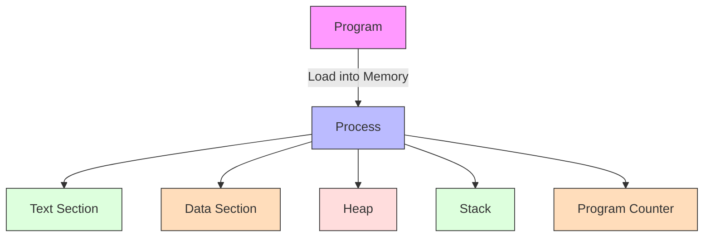

## Process Components

### Memory Layout

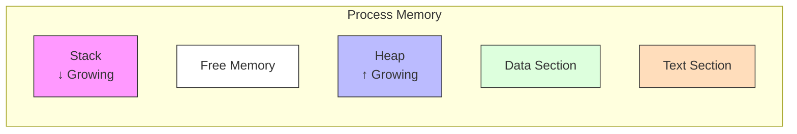

### Process Control Block (PCB)

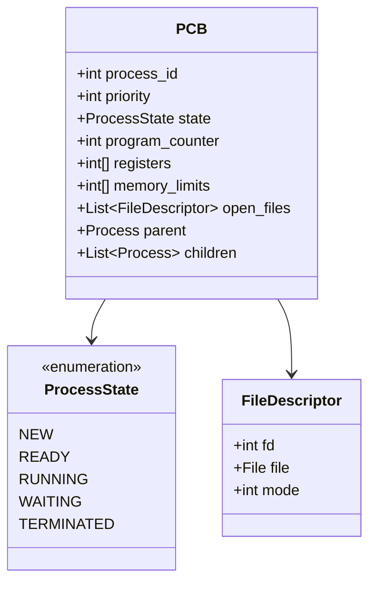

## Process States

### State Diagram

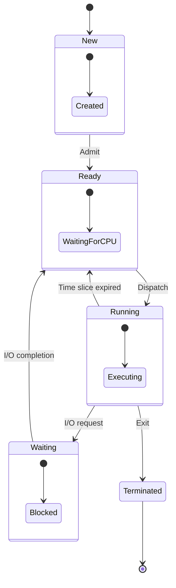

### State Transitions

| From State | To State | Trigger |
|------------|----------|---------|
| New | Ready | Process admitted |
| Ready | Running | CPU allocated |
| Running | Ready | Time slice expired |
| Running | Waiting | I/O request |
| Waiting | Ready | I/O completion |
| Running | Terminated | Process completion |

## Process Operations

### Process Creation

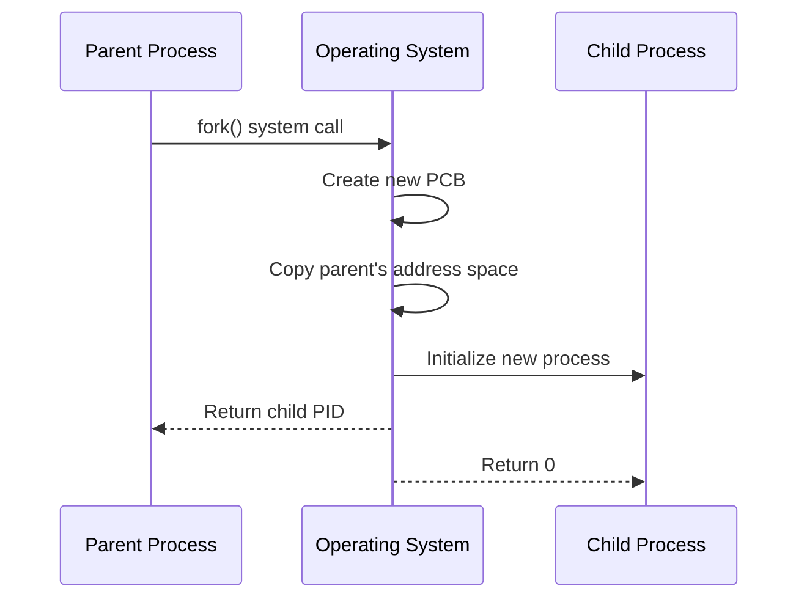

### Process Termination

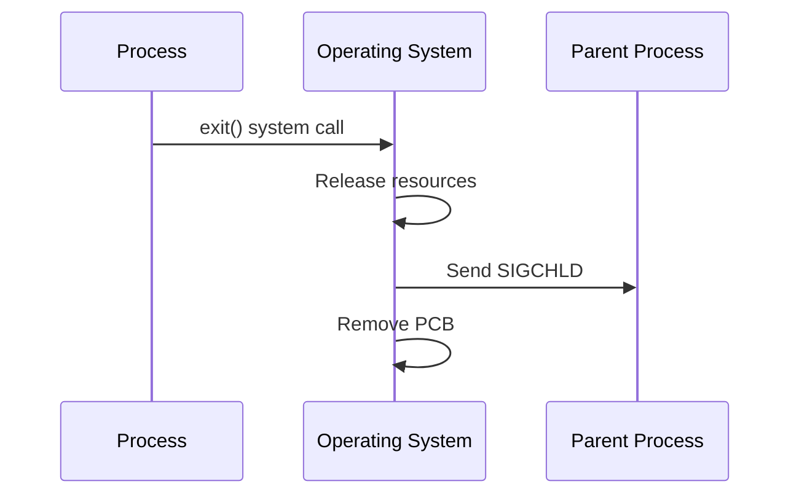

## Interprocess Communication (IPC)

### IPC Models

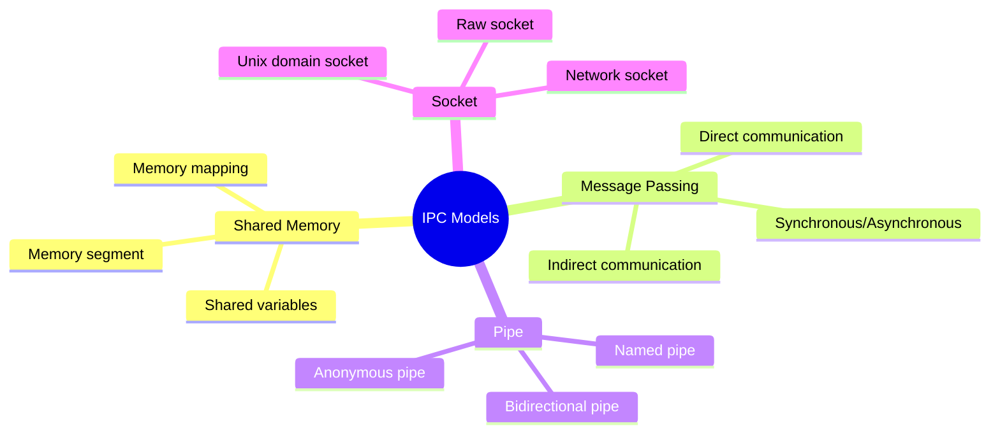

### Shared Memory

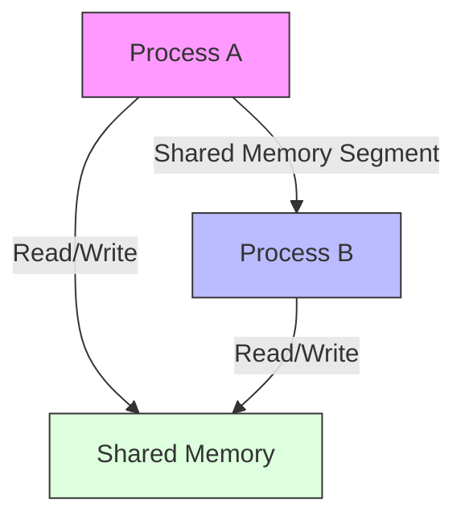

**Example:**
```c
// Process A
int *shared_mem = mmap(NULL, size, PROT_READ|PROT_WRITE, 
                      MAP_SHARED|MAP_ANONYMOUS, -1, 0);
*shared_mem = 42;

// Process B
int *shared_mem = mmap(NULL, size, PROT_READ|PROT_WRITE, 
                      MAP_SHARED|MAP_ANONYMOUS, -1, 0);
printf("Value: %d\n", *shared_mem);
```

### Message Passing

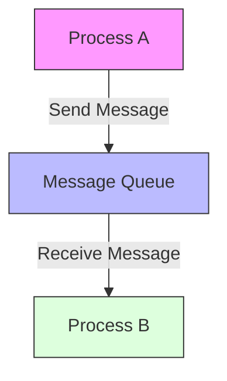

**Example:**
```c
// Process A
struct msgbuf msg;
msg.mtype = 1;
strcpy(msg.mtext, "Hello");
msgsnd(msgid, &msg, sizeof(msg), 0);

// Process B
struct msgbuf msg;
msgrcv(msgid, &msg, sizeof(msg), 1, 0);
printf("Received: %s\n", msg.mtext);
```

## Process Scheduling

### Scheduling Queues

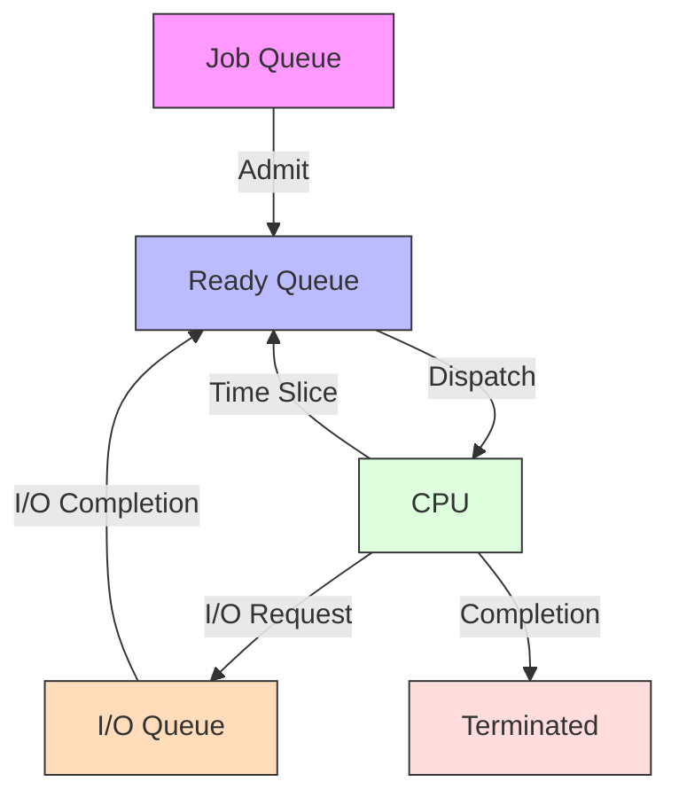

### Context Switching

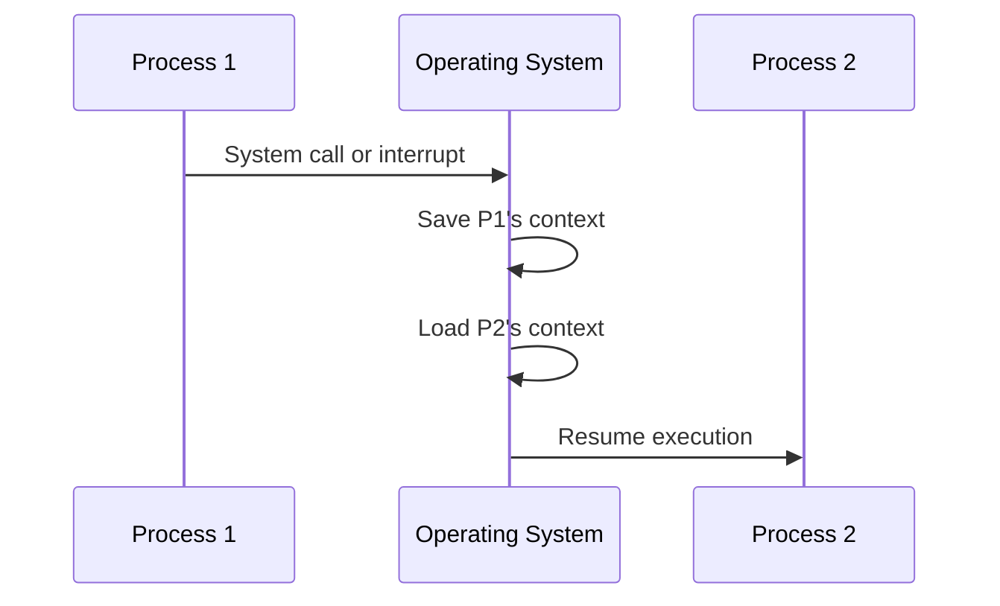

## Real-World Applications

### Web Server Process Model

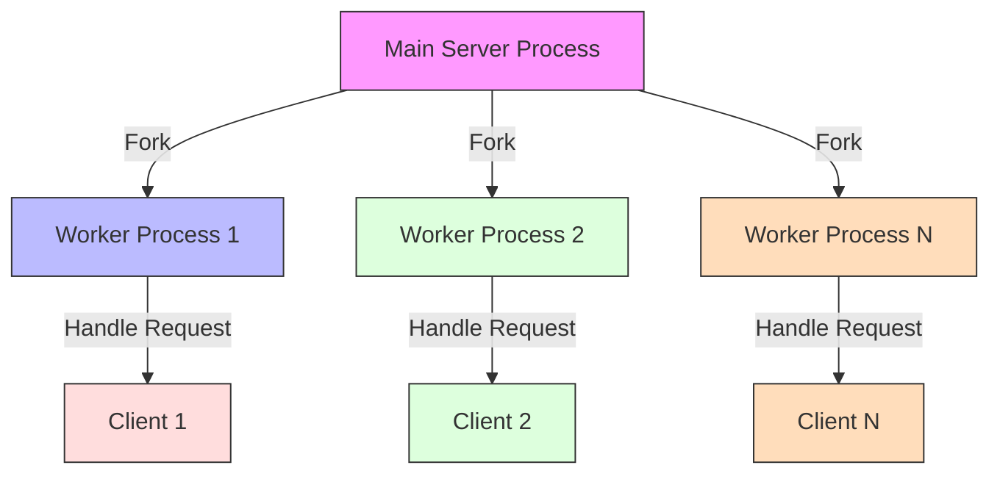

### Database System Process Model

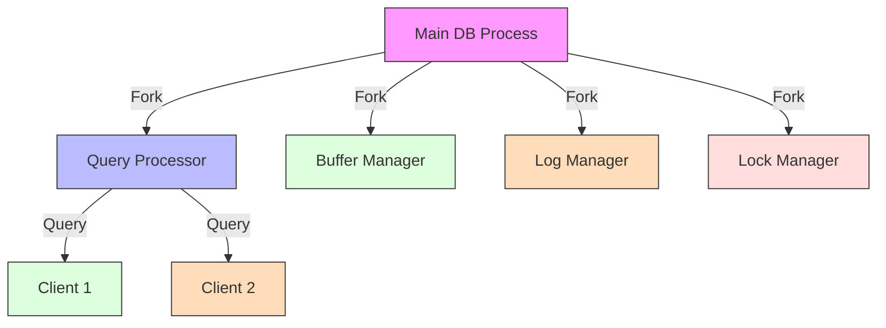

## Performance Considerations

### Process Overhead

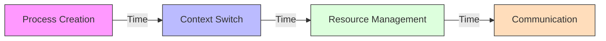

**Factors Affecting Performance:**
1. Process creation time
2. Context switching overhead
3. Memory usage
4. IPC overhead
5. Resource contention

### Optimization Techniques

1. **Process Pooling**
   - Pre-create processes
   - Reuse existing processes
   - Reduce creation overhead

2. **Efficient IPC**
   - Use appropriate IPC method
   - Minimize data copying
   - Batch operations

3. **Resource Management**
   - Proper cleanup
   - Resource limits
   - Memory mapping

## Summary

A process is a program in execution, consisting of program code, data, and resources. The operating system manages processes through the Process Control Block (PCB) and various scheduling queues.

Processes can be in different states (New, Ready, Running, Waiting, Terminated) and transition between these states based on various events. Interprocess communication can be achieved through shared memory, message passing, pipes, or sockets.

Understanding process management is crucial for system programming and application development, as it forms the foundation of concurrent program execution.

## References and Further Reading

- Silberschatz, A., Galvin, P. B., & Gagne, G. (2018). *Operating System Concepts* (10th Edition). Wiley.
- Tanenbaum, A. S., & Bos, H. (2014). *Modern Operating Systems* (4th Edition). Pearson.
- Stevens, W. R., & Rago, S. A. (2013). *Advanced Programming in the UNIX Environment* (3rd Edition). Addison-Wesley.
- Bryant, R. E., & O'Hallaron, D. R. (2015). *Computer Systems: A Programmer's Perspective* (3rd Edition). Pearson.
- Love, R. (2013). *Linux System Programming* (2nd Edition). O'Reilly Media. 