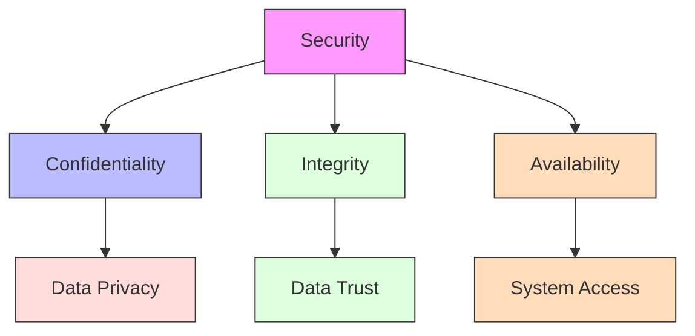
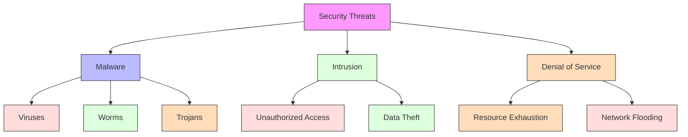
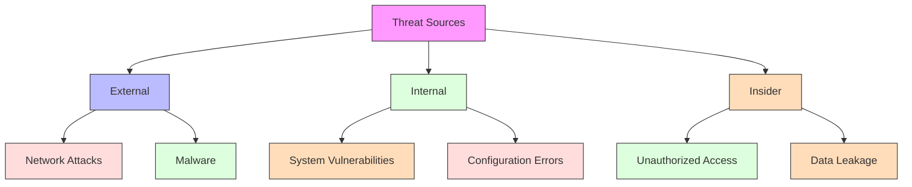
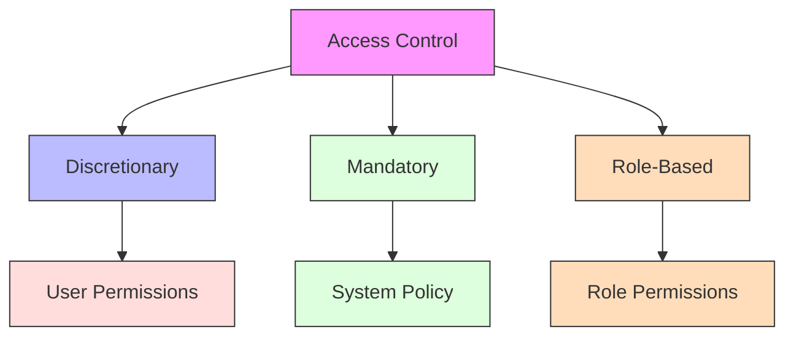
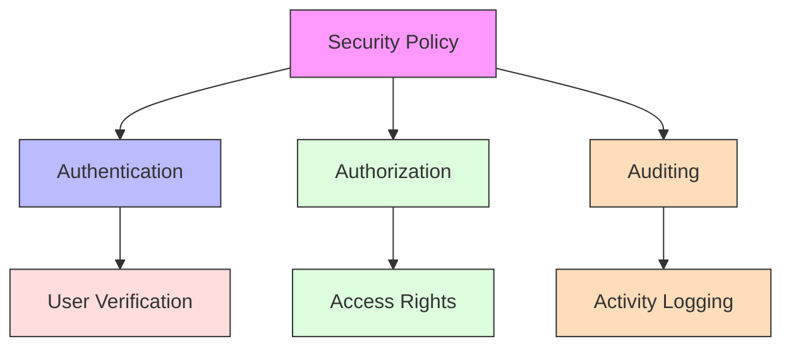
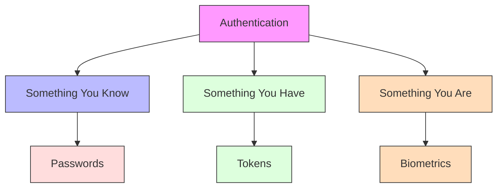
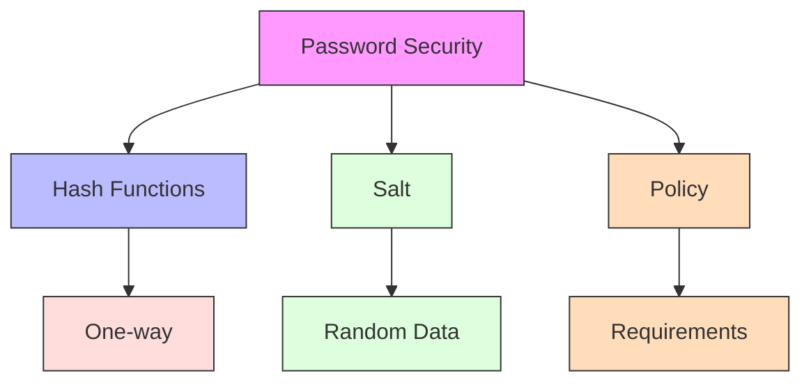
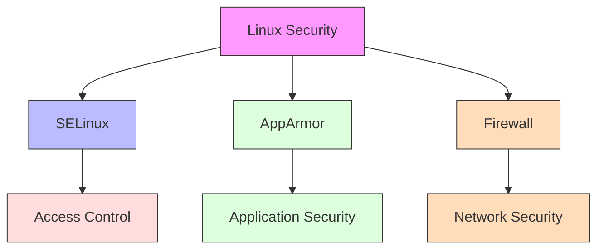
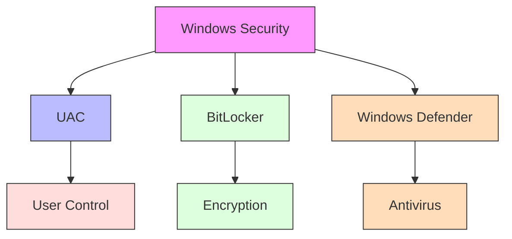
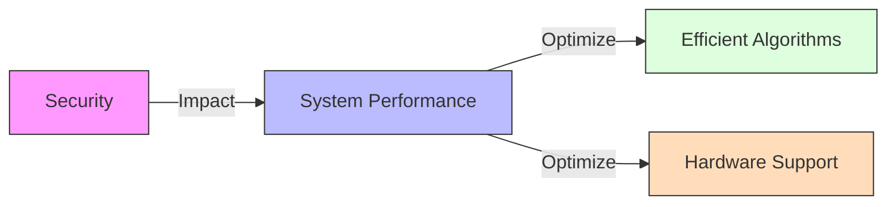

# Security

[Back to Course Content](README.md) | [Previous: I/O Systems](io-systems.md) | [Next: Distributed Systems →](distributed-systems.md)

## What is Security?

Security in operating systems involves protecting system resources and data from unauthorized access, modification, or destruction.

## Security Threats

### Types of Threats

### Threat Sources

## Protection Mechanisms

### Access Control

### Security Policies

## Authentication

### Authentication Methods

### Password Security

## Real-World Applications

### Linux Security

### Windows Security

## Performance Considerations

### Security Overhead

### Optimization Techniques

1. **Efficient Authentication**
   - Fast hash functions
   - Caching mechanisms
   - Hardware acceleration

2. **Access Control**
   - Efficient data structures
   - Caching permissions
   - Role-based optimization

3. **Monitoring**
   - Efficient logging
   - Real-time detection
   - Resource usage

## Summary

Security is a critical aspect of operating systems that protects system resources and data from various threats. Understanding security mechanisms, authentication methods, and performance considerations is essential for system design and implementation.

The choice of security measures depends on various factors including threat levels, system requirements, and performance needs.

## References and Further Reading

- Silberschatz, A., Galvin, P. B., & Gagne, G. (2018). *Operating System Concepts* (10th Edition). Wiley.
- Tanenbaum, A. S., & Bos, H. (2014). *Modern Operating Systems* (4th Edition). Pearson.
- Stevens, W. R., & Rago, S. A. (2013). *Advanced Programming in the UNIX Environment* (3rd Edition). Addison-Wesley.
- Bryant, R. E., & O'Hallaron, D. R. (2015). *Computer Systems: A Programmer's Perspective* (3rd Edition). Pearson.
- Love, R. (2013). *Linux System Programming* (2nd Edition). O'Reilly Media. 