# Synchronization Tools

[Back to Course Content](README.md) | [Previous: CPU Scheduling](cpu-scheduling.md) | [Next: Deadlocks →](deadlocks.md)

## What is Synchronization?

Synchronization is the coordination of multiple processes or threads to ensure correct execution and prevent race conditions. It is essential for maintaining data consistency in concurrent systems.

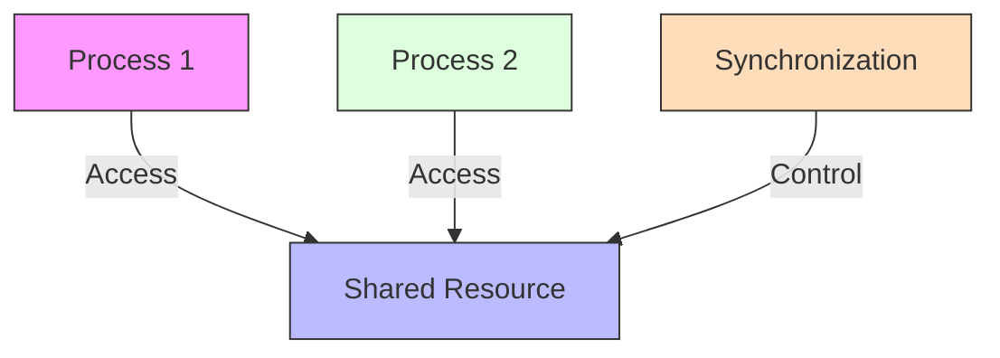

## Critical Section Problem

### Critical Section

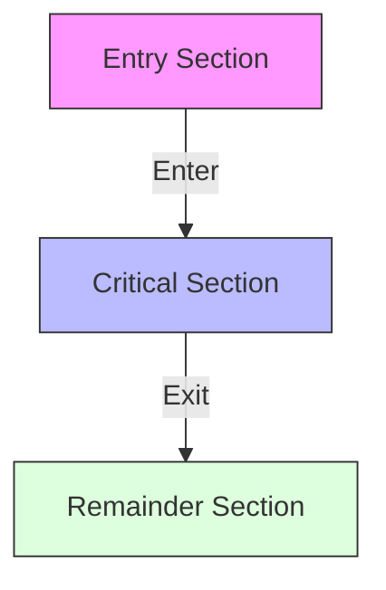

### Requirements

1. **Mutual Exclusion**
   - Only one process can be in critical section
   - No other process can enter while one is inside

2. **Progress**
   - If no process is in critical section
   - Some process must be able to enter

3. **Bounded Waiting**
   - Process must wait finite time to enter
   - No infinite waiting

## Synchronization Hardware

### Test and Set

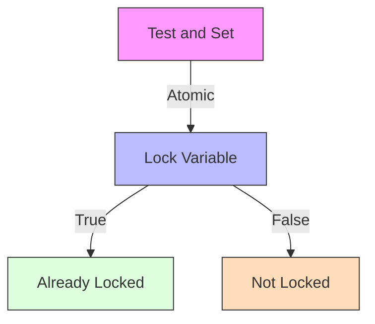

### Compare and Swap

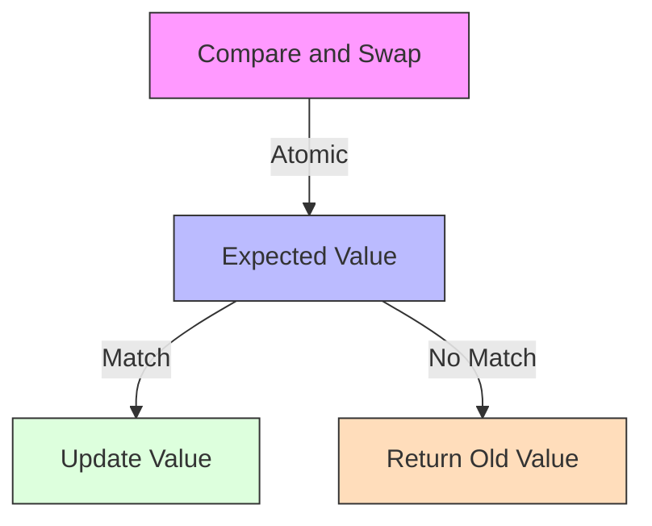

## Semaphores

### Binary Semaphore

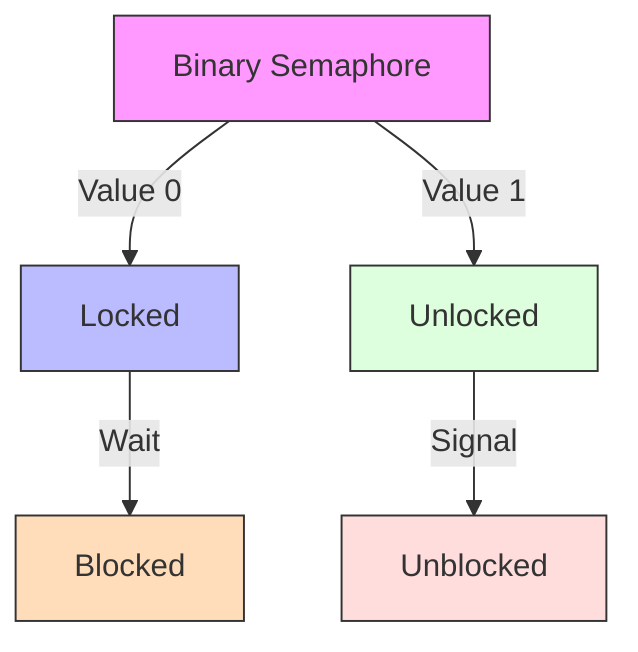

### Counting Semaphore

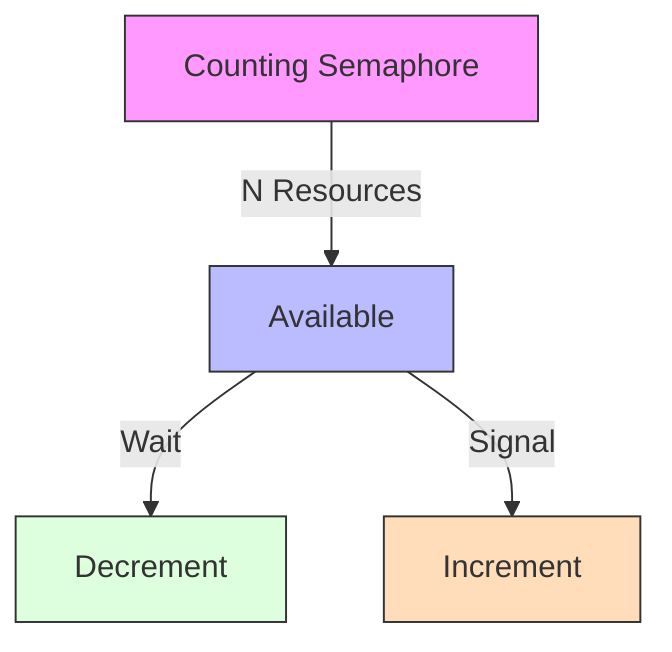

### Implementation

```c
// Semaphore structure
struct semaphore {
    int value;
    struct process *queue;
};

// Wait operation
void wait(semaphore *S) {
    S->value--;
    if (S->value < 0) {
        // Add process to queue
        // Block process
    }
}

// Signal operation
void signal(semaphore *S) {
    S->value++;
    if (S->value <= 0) {
        // Remove process from queue
        // Wake up process
    }
}
```

## Monitors

### Monitor Structure

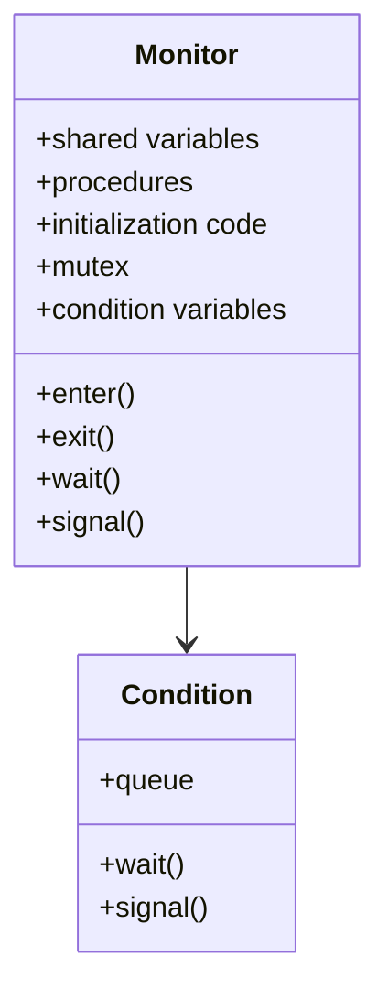

### Monitor Implementation

```c
// Monitor structure
struct monitor {
    mutex_t mutex;
    condition_t *conditions;
    // Shared variables
};

// Enter monitor
void enter(monitor *M) {
    mutex_lock(&M->mutex);
}

// Exit monitor
void exit(monitor *M) {
    mutex_unlock(&M->mutex);
}

// Wait on condition
void wait(monitor *M, condition_t *C) {
    // Add to condition queue
    exit(M);
    // Block process
    enter(M);
}

// Signal condition
void signal(monitor *M, condition_t *C) {
    if (!empty(C->queue)) {
        // Wake up process
    }
}
```

## Synchronization Examples

### Producer-Consumer Problem

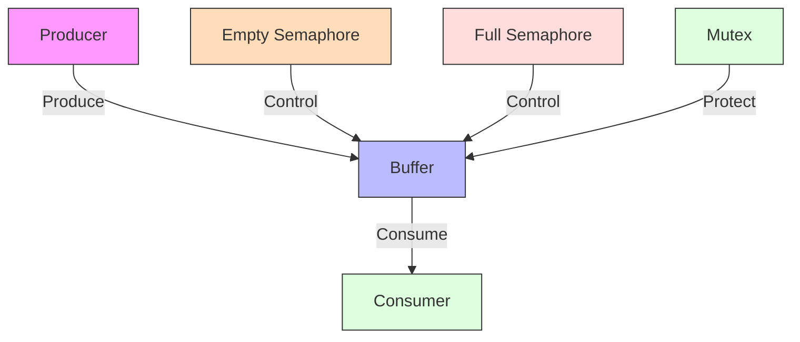

### Readers-Writers Problem

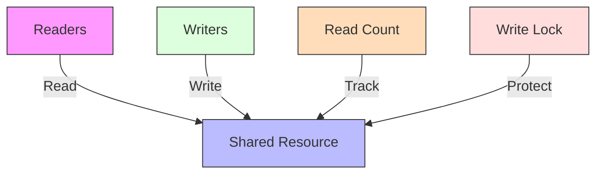

## Real-World Applications

### Database Transaction Management

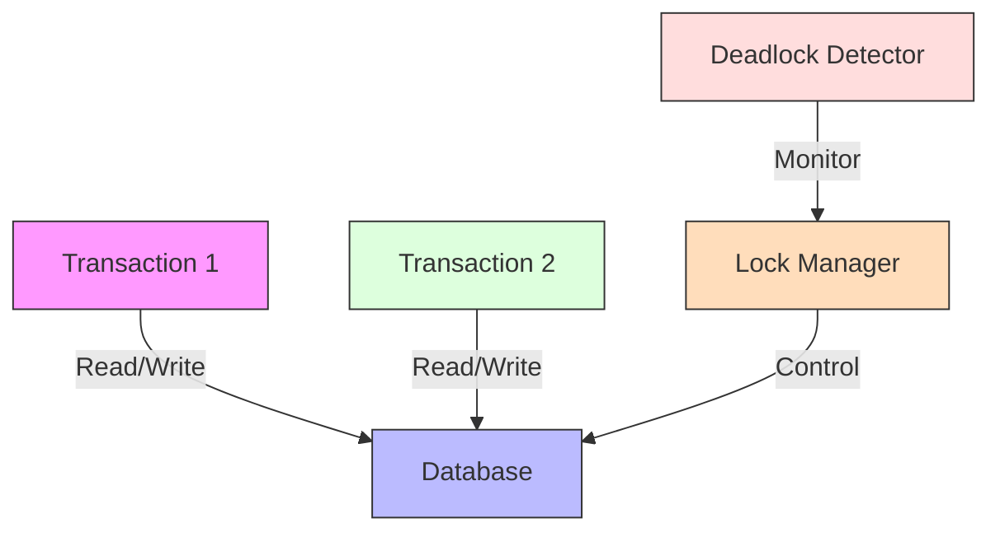

### Web Server Request Handling

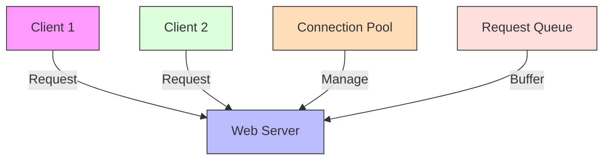

## Performance Considerations

### Synchronization Overhead

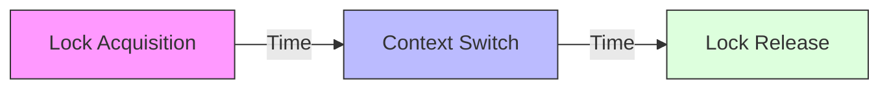

### Optimization Techniques

1. **Fine-grained Locking**
   - Lock smaller data structures
   - Reduce contention
   - Increase concurrency

2. **Lock-free Algorithms**
   - Atomic operations
   - No blocking
   - Better scalability

3. **Read-Write Locks**
   - Multiple readers
   - Single writer
   - Better for read-heavy workloads

## Summary

Synchronization is crucial for maintaining data consistency in concurrent systems. Various tools and mechanisms, such as semaphores and monitors, help coordinate access to shared resources.

The critical section problem illustrates the fundamental challenges of synchronization, and different solutions offer various trade-offs between complexity, performance, and correctness.

Understanding synchronization is essential for developing correct and efficient concurrent applications.

## References and Further Reading

- Silberschatz, A., Galvin, P. B., & Gagne, G. (2018). *Operating System Concepts* (10th Edition). Wiley.
- Tanenbaum, A. S., & Bos, H. (2014). *Modern Operating Systems* (4th Edition). Pearson.
- Stevens, W. R., & Rago, S. A. (2013). *Advanced Programming in the UNIX Environment* (3rd Edition). Addison-Wesley.
- Bryant, R. E., & O'Hallaron, D. R. (2015). *Computer Systems: A Programmer's Perspective* (3rd Edition). Pearson.
- Love, R. (2013). *Linux System Programming* (2nd Edition). O'Reilly Media. 