# Threads and Concurrency

[Back to Course Content](README.md) | [Previous: Processes](processes.md) | [Next: CPU Scheduling →](cpu-scheduling.md)

## What is a Thread?

A thread is a basic unit of CPU utilization within a process. It consists of a thread ID, program counter, register set, and stack. Multiple threads within the same process share code section, data section, and other OS resources.

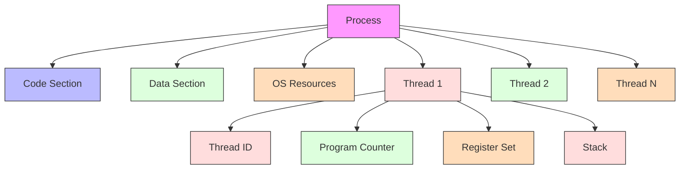

## Thread Models

### User Threads

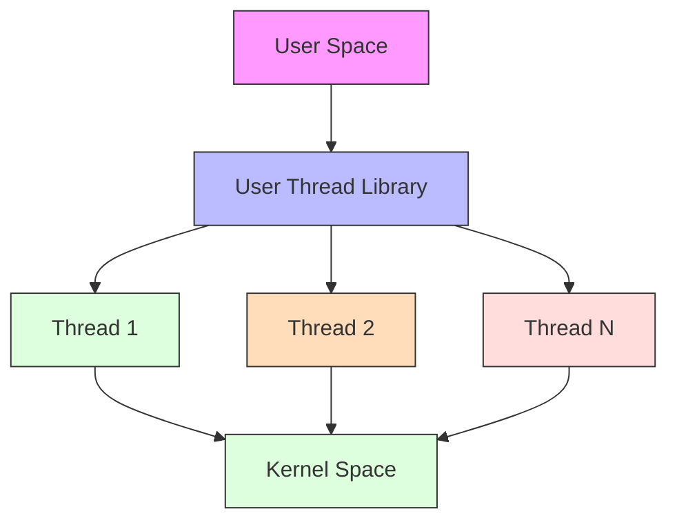

**Advantages:**
- Fast creation and switching
- No kernel intervention
- Custom scheduling algorithms

**Disadvantages:**
- Blocking system calls block all threads
- No parallel execution on multiprocessors
- Limited by kernel thread support

### Kernel Threads

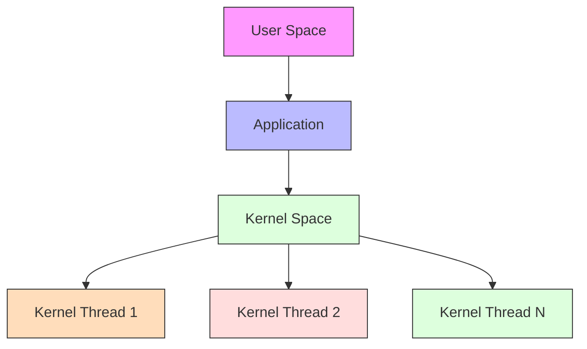

**Advantages:**
- True parallel execution
- Better for CPU-intensive tasks
- System calls don't block other threads

**Disadvantages:**
- Slower creation and switching
- More overhead
- Limited by kernel resources

### Hybrid Threading

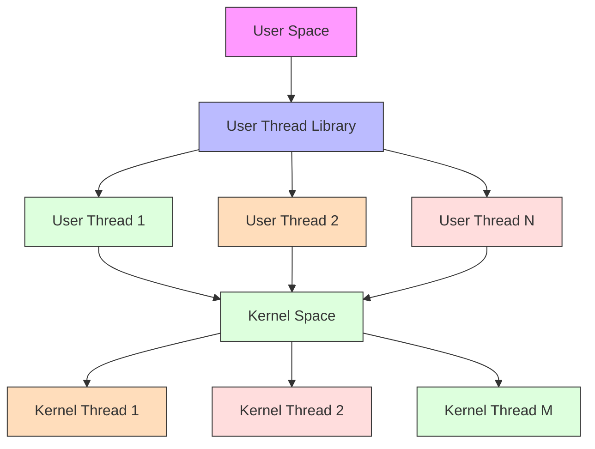

## Thread Libraries

### POSIX Threads (pthreads)

```c
// Thread creation
pthread_t thread;
pthread_create(&thread, NULL, thread_function, arg);

// Thread synchronization
pthread_mutex_t mutex = PTHREAD_MUTEX_INITIALIZER;
pthread_cond_t cond = PTHREAD_COND_INITIALIZER;

// Thread joining
pthread_join(thread, &result);
```

### Windows Threads

```c
// Thread creation
HANDLE thread = CreateThread(NULL, 0, thread_function, arg, 0, &thread_id);

// Thread synchronization
CRITICAL_SECTION cs;
InitializeCriticalSection(&cs);

// Thread joining
WaitForSingleObject(thread, INFINITE);
```

## Thread States

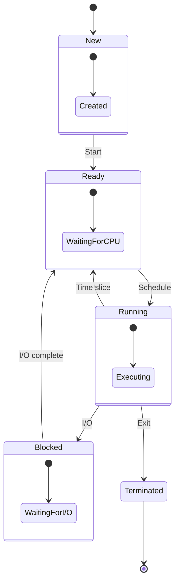

## Thread Synchronization

### Critical Section Problem

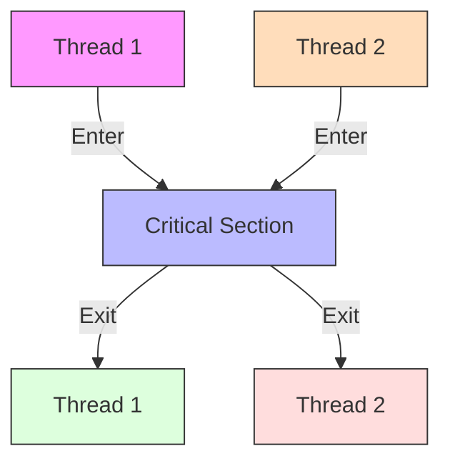

### Mutex Locks

```c
// Mutex operations
pthread_mutex_lock(&mutex);
// Critical section
pthread_mutex_unlock(&mutex);
```

### Semaphores

```c
// Binary semaphore
sem_t sem;
sem_init(&sem, 0, 1);
sem_wait(&sem);
// Critical section
sem_post(&sem);
```

### Monitors

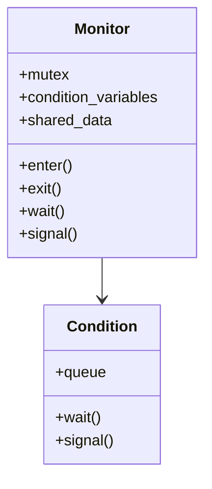

## Thread Pool

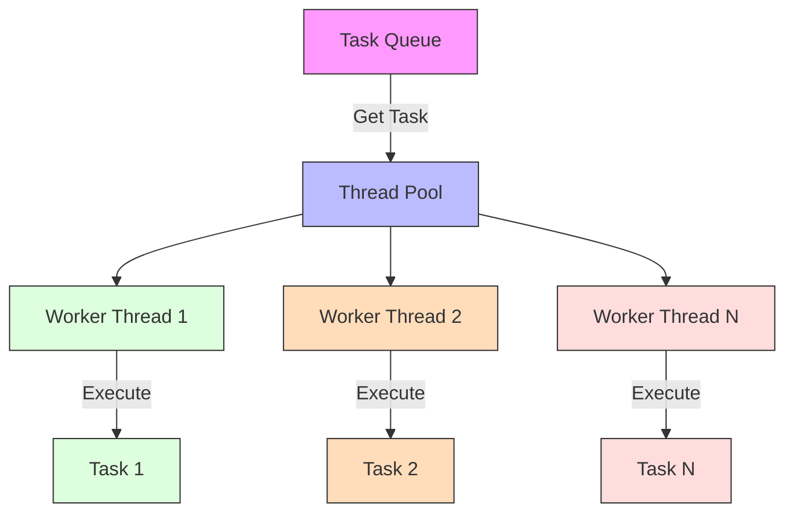

## Real-World Applications

### Web Server Thread Model

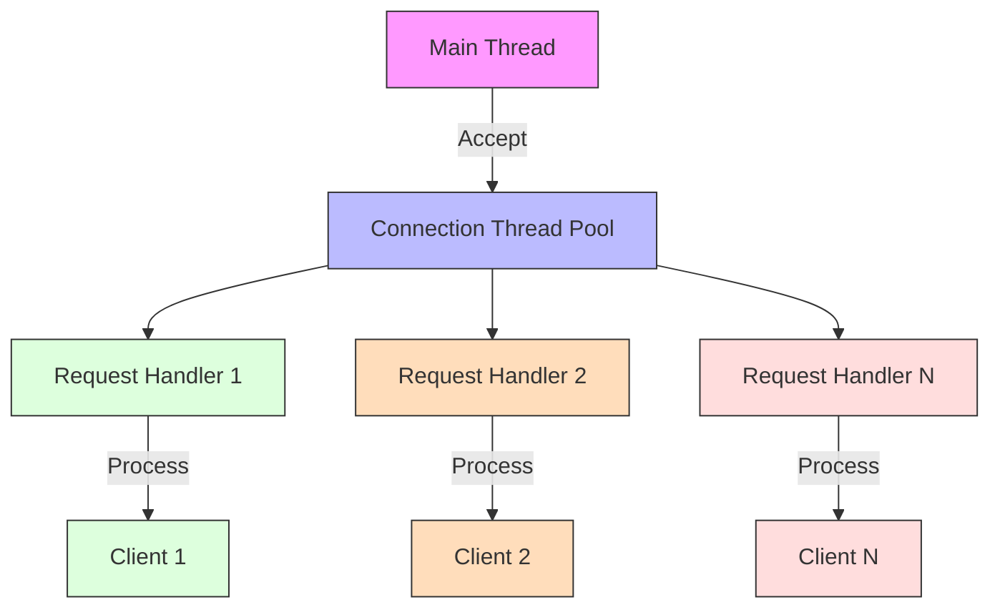

### Database System Thread Model

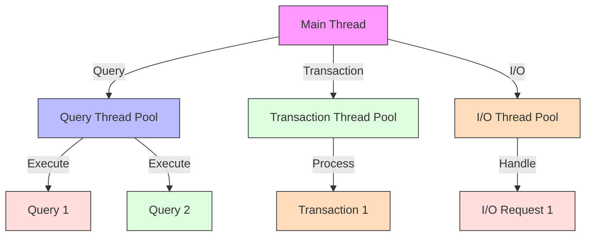

## Performance Considerations

### Thread Overhead

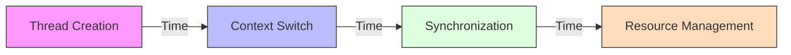

**Factors Affecting Performance:**
1. Thread creation and destruction overhead
2. Context switching overhead
3. Synchronization overhead
4. Resource contention
5. Cache effects

### Optimization Techniques

1. **Thread Pooling**
   - Pre-create threads
   - Reuse existing threads
   - Reduce creation overhead

2. **Efficient Synchronization**
   - Use appropriate synchronization primitives
   - Minimize critical section size
   - Avoid unnecessary synchronization

3. **Resource Management**
   - Proper thread cleanup
   - Resource limits
   - Memory management

## Summary

Threads provide a way to achieve concurrency within a process. They share the process's resources but have their own execution context. Different thread models (user, kernel, and hybrid) offer various trade-offs between performance and functionality.

Thread synchronization is crucial for correct concurrent execution, and various mechanisms (mutexes, semaphores, monitors) are available to ensure thread safety. Thread pools provide an efficient way to manage multiple threads for handling multiple tasks.

Understanding threads and concurrency is essential for developing efficient and correct concurrent applications.

## References and Further Reading

- Silberschatz, A., Galvin, P. B., & Gagne, G. (2018). *Operating System Concepts* (10th Edition). Wiley.
- Tanenbaum, A. S., & Bos, H. (2014). *Modern Operating Systems* (4th Edition). Pearson.
- Stevens, W. R., & Rago, S. A. (2013). *Advanced Programming in the UNIX Environment* (3rd Edition). Addison-Wesley.
- Bryant, R. E., & O'Hallaron, D. R. (2015). *Computer Systems: A Programmer's Perspective* (3rd Edition). Pearson.
- Love, R. (2013). *Linux System Programming* (2nd Edition). O'Reilly Media. 